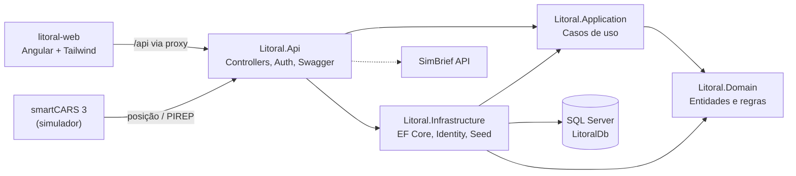

<div align="center">


# Litoral Linhas Aéreas

**Virtual Airline focada em simulação, conectando o Brasil às Américas.**

`ICAO: LTL` · `Callsign: LITORAL`


</div>

---

## Sumário

- [Sobre o projeto](#sobre-o-projeto)
- [Identidade da companhia](#identidade-da-companhia)
- [Operação](#operação)
- [Carreira do piloto](#carreira-do-piloto)
- [Reserva de voos](#reserva-de-voos)
- [Pontos](#pontos)
- [Estrutura de staff](#estrutura-de-staff)
- [Stack](#stack)
- [Arquitetura](#arquitetura)
- [Estrutura de pastas](#estrutura-de-pastas)
- [Como rodar o projeto](#como-rodar-o-projeto)
- [Roadmap](#roadmap)
- [Autor](#autor)

---

## Sobre o projeto

A **Litoral Linhas Aéreas** é uma companhia aérea virtual (VA) para pilotos de simulador. Voamos pelo Brasil e para destinos na América do Sul, América Central, América do Norte e Europa, com frota 100% Boeing 737.

O sistema reúne em um só lugar:

- Cadastro de pilotos, base e carreira (FO → CMD)
- Frota com **localização real**: cada avião fica onde pousou pela última vez, com horas, ciclos e manutenção
- Reserva de voos aleatórios, personalizados, **escala mensal** e escalas especiais
- Tripulação virtual: todo voo tem um segundo piloto da VA escalado
- Briefing integrado ao **SimBrief**
- Acompanhamento do voo via **ACARS (smartCARS 3)** e envio automático de **PIREP**
- Pontuação por desempenho, extrato de pontos e promoção automática
- Painel administrativo com permissões por posição de staff

Compatibilidade planejada com **MSFS 2020, MSFS 2024, X-Plane 11/12 e Prepar3D**, voando nas networks **IVAO** e **VATSIM**.

---

## Identidade da companhia

| | |
|---|---|
| **Nome** | Litoral Linhas Aéreas |
| **ICAO** | `LTL` |
| **Callsign (rádio)** | `LITORAL`, por exemplo *"Litoral three four one two"* |
| **Idioma do site** | Inglês. Regulamento e Política de Privacidade em inglês e português |
| **Temas** | Claro (padrão), escuro ou automático pelo sistema |

### Paleta "Costa atlântica"

| Cor | Hex | Uso |
|---|---|---|
| 🟦 Atlântico | `#1D6FD8` | Cor principal da marca |
| 🟩 Onda | `#2EC4B6` | Cor secundária e onda da cauda |
| 🟨 Sol | `#FFD166` | Destaques e badges |
| 🟥 Hibisco | `#EF476F` | Detalhes da marca |
| ⬛ Azul-marinho | `#0A1F3C` | Texto e fundo do tema escuro |
| ⬜ Areia | `#FDFCF7` | Fundo do tema claro |

### Livery

Fuselagem **branca**, cauda **azul** com a **onda turquesa** e detalhe **amarelo** no topo, e o nome "LITORAL" em azul. Cada matrícula tem uma **faixa de cor diferente** na fuselagem (Onda, Sol, Hibisco ou Pôr do sol). Essas faixas aparecem apenas nas pinturas, não no site.

---

## Operação

### Aeroportos, operação e hubs

Cada aeroporto tem a **operação da Litoral** naquele local: **passageiros**, **cargueiro** ou ambos. Alguns aeroportos são marcados como **hub**.

| ICAO | Cidade | Operação | Base |
|---|---|---|:---:|
| SBGR | São Paulo (Guarulhos) | Passageiros | ✅ |
| SBFL | Florianópolis | Passageiros | ✅ |
| SBBR | Brasília | Passageiros | ✅ |
| SBEG | Manaus | Passageiros e cargueiro | ✅ |
| SBFZ | Fortaleza | Passageiros e cargueiro | ✅ |
| SBKP | Campinas (Viracopos) | Cargueiro | |

- Todos os aeroportos acima são **hubs**. Os hubs com operação de passageiros são as **bases** que o piloto pode escolher no cadastro.
- Rotas de passageiros exigem operação de passageiros nos dois aeroportos, e rotas cargueiras exigem operação de cargueiro nos dois.
- As coordenadas são cadastradas no formato do **AISWEB/ROTAER**, com ou sem espaços: `12 54 31S` / `038 19 21W` ou `125431S` / `0381921W`.
- **Busca por ICAO:** ao digitar o ICAO no cadastro, nome, cidade, país e coordenadas são preenchidos a partir do catálogo do [OurAirports](https://ourairports.com/data/) (cerca de 19 mil aeroportos), importado automaticamente na primeira execução.
- Fotos de aeroportos virão do **Wikimedia Commons**, com crédito e licença exibidos.

### Acesso aos aeroportos por patente

Cada aeroporto tem uma **patente mínima**, definida pelo Route Manager no cadastro:

| Patente mínima | Quem pode operar |
|---|---|
| **FO** | Todos os pilotos |
| **CMD** | Somente comandantes |

- **Hubs são sempre FO.**
- Se um aeroporto passar a ser CMD, os FOs que estiverem nele são **movidos para a base**.
- Reservas, rotas e jumpseat mostram **apenas os aeroportos que a patente do piloto permite**.

### Frota

| ICAO | Aeronave | Operação | Alcance de referência | Matrículas |
|---|---|---|---|---|
| B738 | Boeing 737-800 | Passageiros | 2.900 NM | `PS-LA_` |
| B738 | Boeing 737-800BCF | Cargueiro | 2.000 NM | `PS-LB_` |
| B737 | Boeing 737-700 | Passageiros | 3.000 NM | `PS-LC_` |
| B739 | Boeing 737-900ER | Passageiros | 2.900 NM | `PS-LD_` |
| B38M | Boeing 737 MAX 8 | Passageiros | 3.500 NM | `PS-LE_` |
| B736 | Boeing 737-600 | Passageiros | 3.000 NM | `PS-LF_` |

- Os tipos de aeronave são cadastrados pelo Fleet Manager: ICAO, nome, operação, alcance, **prefixo de matrícula** e **intervalo de manutenção**.
- O sistema calcula a distância das rotas pelas coordenadas dos aeroportos e **não permite cadastrar uma rota maior que o alcance da aeronave**.
- Cada aeronave tem **localização real**. Ela só pode ser reservada no aeroporto onde está, e ao fim do voo fica no destino.
- Cada aeronave acumula **horas, ciclos** e **horas desde a última manutenção**.
- Status de cada aeronave: **Disponível**, **Reservada**, **Em voo**, **Manutenção** ou **Inativa**.
- Fotos das aeronaves são enviadas manualmente, com campo de **crédito do fotógrafo**. Use apenas fotos próprias ou autorizadas.

#### Matrículas

- Padrão da Litoral: **`PS-L` + letra do tipo + letra da sequência**. Exemplo: o primeiro B738 é `PS-LAA`, o segundo `PS-LAB`, e assim por diante.
- Ao cadastrar uma aeronave, o sistema sugere a **próxima matrícula livre** do bloco do tipo.
- Enquanto o bloco tiver vaga, só são aceitas matrículas dele. Quando o bloco **esgota**, o Fleet Manager escolhe outra matrícula livre: `PP`, `PR`, `PS`, `PT` ou `PU` + 3 letras.
- Matrículas dentro do bloco de outro tipo não são aceitas.
- Seguindo o **RBAC 45 da ANAC (45.23-I)**, são bloqueadas as combinações que começam com **Q**, que têm **W como segunda letra** e as reservadas **SOS, XXX, PAN, TTT, VFR, IFR, VMC e IMC**.

#### Manutenção

- Cada tipo tem um **intervalo de manutenção** em horas de voo (padrão **500 h**, editável).
- O Fleet Manager pode mandar uma aeronave para a manutenção com um motivo, escolhendo o retorno **manual** ou **em uma data**. Na data, ela volta sozinha ao serviço.
- Ao vencer o intervalo, a aeronave entra em manutenção **automaticamente** ao concluir o voo.
- Se ela não estiver no **hub de manutenção** (a definir), é criada uma **escala especial de traslado** para um CMD levar a aeronave até lá.

### Numeração dos voos

| Bloco | Uso |
|---|---|
| `1000–4999` | Doméstico (Brasil) |
| `5000–5999` | América do Sul |
| `6000–6999` | América Central e do Norte |
| `7000–7999` | Voos sazonais |
| `8000–8999` | Europa e demais destinos |
| `9000–9999` | Translado, cargueiro e callsign alternativo |

**Sugestão de número:** no cadastro de rotas, o sistema sugere o próximo número livre do bloco, ímpar na ida e o par seguinte na volta (ex.: `LTL1003` / `LTL1004`). O bloco é escolhido pelo país e continente dos aeroportos, e rotas cargueiras sempre usam o `9xxx`.

### Rotas

- Cada rota tem um ou mais **tipos de aeronave** permitidos, todos de passageiros ou todos cargueiros.
- A distância precisa estar dentro do alcance de **todos** os tipos escolhidos.
- No cadastro é possível criar a **rota de volta** junto.
- Rotas com reservas não podem ser excluídas, apenas **desativadas**.
- Se o ICAO digitado não estiver cadastrado, o Route Manager pode cadastrar o aeroporto ali mesmo.

**Callsign alternativo em network:** se o callsign do voo já estiver em uso na IVAO ou na VATSIM, o piloto usa **`LTL9` + os 3 últimos dígitos do seu número de piloto**. Exemplo: piloto 1042 → `LTL9042`.

---

## Carreira do piloto

Cada piloto recebe um **número sequencial** a partir de **1000**, exibido junto da patente atual (ex.: `FO1001`, `CMD1002`). O login é feito por **e-mail e senha**.

| Patente | Requisitos |
|---|---|
| **FO**: First Officer | Todo piloto que entra na VA |
| **CMD**: Captain | **500 h** de voo **e** **30.000 pontos** |

- A promoção e o rebaixamento são **automáticos**.
- Se um CMD ficar abaixo de **30.000 pontos**, ele volta a ser **FO**.

### Base e localização

- No cadastro o piloto escolhe a sua **base** entre os hubs de passageiros.
- O piloto tem uma **localização atual**: começa na base e muda a cada voo concluído.
- **Jumpseat:** pela página de aeroportos, o piloto pode se deslocar para outro aeroporto sem voar, desde que a patente permita. É **grátis para as bases** e custa **50 pontos** para os demais aeroportos.
- **Rebaixamento:** se o piloto estiver em um aeroporto só de CMD quando voltar a ser FO, ele é **movido automaticamente para a base**.

---

## Reserva de voos

O piloto sempre parte da **sua localização atual**, com uma aeronave que **esteja no aeroporto de partida**.

| Tipo | Como funciona | Custo |
|---|---|---|
| **Aleatório** | Filtro por duração (até 1 h, 1–2 h, mais de 2 h ou qualquer). O sistema sorteia a rota e uma aeronave disponível no aeroporto. Se não houver aeronave, o piloto pode trazer uma para lá sem custo. | Grátis |
| **Personalizado** | O piloto escolhe qualquer rota que saia do aeroporto onde está. | Grátis para uma base; **50 pontos** para os demais destinos |
| **Escala mensal** | Sequência de voos gerada para o mês (veja abaixo). | Grátis, com bônus |
| **Escala especial** | Voos criados pelo staff, como traslados para manutenção. O primeiro piloto que reservar fica com o voo. | **+200 pontos** ao concluir |

**Escolha da aeronave:** no voo personalizado e na escala mensal, ao clicar no destino abre a tela de seleção. Ela tem a opção **Random selection** e os cards das aeronaves disponíveis no aeroporto, agrupados por tipo, com foto, matrícula, variante e último voo. No voo aleatório, a aeronave é escolhida automaticamente.

Depois da reserva, o callsign do voo aparece no menu no lugar de "Reservar voo", com a opção de cancelar. O piloto só pode ter **um voo reservado por vez**.

**Expiração:** toda reserva expira em **24 h** se o voo não for iniciado (escala especial: **48 h**). A aeronave volta a ficar disponível. Na escala mensal, o voo só é reservado quando o piloto clica no card, e a contagem começa a partir daí. Se expirar, o voo continua na escala como o próximo a ser feito.

### Tripulação

Todo voo tem um **segundo piloto da VA** escalado automaticamente na reserva:

- Quem reserva é **FO** → o sistema escala um **CMD**. Quem reserva é **CMD** → o sistema escala um **FO**.
- O piloto escalado não precisa fazer nada. Ele só aparece no briefing, simulando a tripulação.
- Só pode ser escalado quem está ativo, **não tem reserva própria em aberto** e não está escalado em outro voo. Entre os livres, vai **quem foi escalado há mais tempo**.
- Se ninguém estiver livre, o voo sai **sem segundo piloto**.
- Quando o voo é concluído, o piloto escalado ganha **10 pontos** (sem horas de voo).
- Se o voo for cancelado ou expirar, o piloto escalado é liberado e não ganha nada. A expiração **não gera punição** para quem fez a reserva.

### Escala mensal

- Gerada na **primeira vez** que o piloto abre a página no mês.
- Tamanho: **dias restantes do mês** (incluindo hoje) **× 1, 2 ou 3 voos por dia**, à escolha do piloto.
- A escala **sempre começa e termina na base** do piloto.
- É dividida em **sequências de 5 a 7 voos**. Cada sequência termina na base, como um "tiro" da vida real, e a próxima começa de lá.
  - Exemplo: `SBFL → SBGR → SBSV → SBGR → SBFZ → SBGR → SBFL` · `SBFL → SBPA → SBCT → SBRJ → SBSP → SBFL`
  - Totais que não fecham em 5 a 7 são divididos o mais igualmente possível (ex.: 8 voos → 4 + 4). Abaixo de 5 voos, a escala tem uma sequência só. O mínimo é de 2 voos.
  - No simulador não há folga entre as sequências: ao voltar à base, a próxima já começa de lá.
- Mistura voos de **passageiros e cargueiros** (bloco `9xxx`).
- Os voos são feitos **em ordem**: só o próximo voo da escala pode ser reservado.
- Se o piloto não estiver no aeroporto de partida de um voo da escala, o card mostra a tag **Indisponível**. Ao reservar, ele faz um **jumpseat automático e sem custo** até a partida.
- Com um voo aleatório ou personalizado em aberto, a escala avisa que já existe um voo em aberto.
- Usa apenas rotas e aeroportos que a patente do piloto permite.
- Bônus de **100 pontos por voo** da escala ao concluí-la.
- Quem terminar a escala antes do fim do mês só recebe uma nova no mês seguinte.

---

## Pontos

Todo movimento de pontos fica registrado no **extrato do piloto**:

| Tipo | Exemplo |
|---|---|
| Pontuação do voo | Pontos ganhos ou perdidos conforme o desempenho |
| Custo de reserva | Voo personalizado para fora das bases |
| Jumpseat | Deslocamento para aeroportos que não são base |
| Tripulação | 10 pontos por voo concluído em que o piloto foi escalado |
| Bônus de escala mensal | 100 pontos por voo da escala concluída |
| Escala especial | **+200 pontos** por escala concluída |
| Penalidade | Aplicada na análise do PIREP, ou **−500 pontos** se uma escala especial reservada vencer sem ser feita |
| Ajuste manual | Correção feita pelo staff |

A tabela de pontuação por desempenho (pouso, procedimentos, desvios) será definida na fase do ACARS.

---

## Estrutura de staff

Todo staff também é piloto. Cada posição tem **uma única função** no sistema. Uma pessoa pode acumular mais de uma posição.

As permissões são aplicadas por **policies** na API. O **CEO & Founder** acessa todas as áreas, e o menu **Admin** do site mostra a cada pessoa só as áreas das suas posições.

### Executive Team

| Posição | Função | Vagas |
|---|---|:---:|
| CEO & Founder | Acesso total | 1 |
| Chairman | Gestão do staff (atribuir e remover posições) | 1 |
| Vice Chairman | Substitui o Chairman, com a mesma permissão | 1 |
| General Director | Painel geral: estatísticas, relatórios e logs | 1 |

### Operations Team

| Posição | Função | Vagas |
|---|---|:---:|
| Head of HR | Gestão de pilotos: inativar, reativar e excluir | 1 |
| Director of Operations | Tours, eventos e escalas especiais | 1 |
| Fleet Manager | Tipos de aeronave, matrículas, fotos e manutenção | 1 |
| Route Manager | Rotas, aeroportos (operação, patente mínima e hub) | 1 |

### Safety Team

| Posição | Função | Vagas |
|---|---|:---:|
| Safety Manager | Análise e aprovação de PIREPs | Várias |

---

## Stack

**Back-end**
- .NET 10 (LTS) / ASP.NET Core Web API
- Entity Framework Core 10 + SQL Server
- ASP.NET Core Identity + JWT
- OpenAPI + Swagger UI
- Clean Architecture

**Front-end**
- Angular 22 (standalone, signals e zoneless)
- Tailwind CSS 4
- Leaflet + mapas CARTO
- Tabler Icons
- Tema claro, escuro e automático

**Integrações**
- SimBrief (geração e leitura de OFP)
- **smartCARS 3**: a API do Litoral implementa a [especificação REST](https://github.com/invernyx/smartcars-3-phpvms5-api/blob/development/openapi.json) usada pelo app, em .NET, sem PHP
- **OurAirports**: catálogo de aeroportos para a busca por ICAO
- **Wikimedia Commons**: fotos de aeroportos (planejado)

---

## Arquitetura



| Camada | Responsabilidade |
|---|---|
| **Domain** | Entidades e regras de negócio: blocos de voo, callsign, alcance, patentes, base, localização, frota, pontos e staff |
| **Application** | Contratos e casos de uso: cadastro, booking, PIREP, promoção |
| **Infrastructure** | Banco de dados, Identity, JWT, migrations, seed e serviços |
| **Api** | Endpoints HTTP, tratamento de erros e documentação |

---

## Estrutura de pastas

```
litoral-linhas-aereas/
├── src/
│   ├── Litoral.Domain/          # Entidades, enums, staff e regras
│   ├── Litoral.Application/     # Contratos e casos de uso
│   ├── Litoral.Infrastructure/  # DbContext, configurações, migrations, seed, auth
│   └── Litoral.Api/             # Controllers, Program.cs, Swagger e wwwroot/uploads (fotos)
├── litoral-web/                 # Front-end Angular
│   ├── public/                  # favicon e insígnias das patentes
│   └── src/app/
│       ├── core/                # auth, api, admin, staff, tema, dados de referência, config
│       ├── shared/              # header, mapa, pipes, diretivas e utilitários (coordenadas, voos, matrículas)
│       └── pages/               # home pública, login, cadastro, dashboard, perfil e admin
├── Litoral.slnx
└── package.json                 # script para rodar API + front juntos
```

---

## Como rodar o projeto

### Pré-requisitos

- [.NET SDK 10](https://dotnet.microsoft.com/download)
- [Node.js](https://nodejs.org/) 22.12+ ou 24 LTS
- SQL Server (Express, Developer ou LocalDB)
- Ferramenta de migrations do EF Core:
  ```bash
  dotnet tool install --global dotnet-ef --version 10.0.8
  ```

### Passo a passo

**1. Clone o repositório**
```bash
git clone https://github.com/alexandrefgs/litoral-linhas-aereas.git
cd litoral-linhas-aereas
```

**2. Instale as dependências do front e do script de desenvolvimento**
```bash
npm install
npm --prefix litoral-web install
```

**3. Configure a conexão com o banco** em `src/Litoral.Api/appsettings.Development.json`:
```json
{
  "ConnectionStrings": {
    "Litoral": "Server=localhost\\SQLEXPRESS;Database=LitoralDb;Trusted_Connection=True;TrustServerCertificate=True"
  }
}
```
Ajuste o `Server` conforme a sua instalação: `localhost`, `localhost\\SQLEXPRESS` ou `(localdb)\\MSSQLLocalDB`.

**4. Configure a chave do mapa** em `litoral-web/src/app/core/config/app-config.ts`.
Os mapas usam tiles da [CARTO](https://carto.com/), que exigem uma chave gratuita. A chave do repositório funciona apenas em `localhost`; para outro domínio, crie a sua.

**5. Confie no certificado HTTPS de desenvolvimento** (uma vez só)
```bash
dotnet dev-certs https --trust
```

**6. Rode a API e o front juntos**
```bash
npm run dev
```

Em ambiente de desenvolvimento, a API **aplica as migrations e o seed automaticamente** ao iniciar: patentes, tipos de aeronave com prefixo de matrícula, aeroportos, hubs e posições de staff. Na primeira execução, ela também importa o catálogo de aeroportos do OurAirports, o que leva alguns segundos. O **primeiro usuário cadastrado** vira CEO & Founder.

| Serviço | Endereço |
|---|---|
| Site | http://localhost:4200 |
| Swagger | https://localhost:7112/swagger |
| Health check | https://localhost:7112/api/health |

> A porta da API pode variar. Confira em `src/Litoral.Api/Properties/launchSettings.json` e, se mudar, atualize `litoral-web/proxy.conf.json`.

### Comandos úteis

| Comando | O que faz |
|---|---|
| `npm run dev` | Sobe API e front juntos |
| `npm run api` | Sobe só a API (com hot reload) |
| `npm run web` | Sobe só o front |
| `dotnet build` | Compila a solução |
| `dotnet ef migrations add Nome --project src/Litoral.Infrastructure --startup-project src/Litoral.Api --output-dir Persistence/Migrations` | Cria uma migration |

---

## Roadmap

### ✅ Fase 0: Fundação
- [x] Solução .NET 10 em Clean Architecture
- [x] Domain: aeroportos, hubs, frota, rotas, pilotos, bookings e patentes
- [x] Regras de blocos de numeração e callsign alternativo em network
- [x] Validação de alcance da aeronave por rota
- [x] Entity Framework Core + SQL Server + migrations
- [x] ASP.NET Core Identity
- [x] Seed: patentes, frota 737, aeroportos, hubs e posições de staff
- [x] Regra de promoção e rebaixamento automáticos (horas + pontos)
- [x] Swagger
- [x] Front-end Angular 22 + Tailwind CSS 4
- [x] Site em inglês (Regulamento e Privacidade terão versão em português)
- [x] Tema claro, escuro e automático
- [x] Identidade visual: paleta, favicon e conceito de livery
- [x] API e front rodando juntos com `npm run dev`

### ✅ Fase 1: Autenticação, pilotos e site público
- [x] Cadastro com nome, e-mail, senha e escolha da base
- [x] Número de piloto automático a partir de 1000
- [x] Primeiro usuário cadastrado vira CEO & Founder
- [x] Login com JWT e botão Authorize no Swagger
- [x] Telas de login e cadastro
- [x] Perfil do piloto com SimBrief Username
- [x] Dashboard do piloto: mapa, patente, horas, pontos e progresso para CMD
- [x] Site público: início, sobre, operação, números e últimos voos
- [x] Menu com NOTAMs e notícias
- [x] Redirecionamento: piloto logado vai para o dashboard, visitante vê a home

### 🔜 Fase 2: Regras de operação, staff e cadastros
- [x] Frota com matrícula, variante, foto e localização real
- [x] Extrato de pontos (ledger)
- [x] Patente mínima por aeroporto (FO ou CMD)
- [x] Base do piloto e retorno automático à base no rebaixamento
- [x] Jumpseat respeitando a patente
- [x] Autorização por posição de staff (policies)
- [x] Área administrativa com menu conforme as posições do usuário
- [x] **Route Manager:** aeroportos (operação, FO/CMD, hub e coordenadas AISWEB)
- [x] Busca de aeroporto por ICAO (catálogo OurAirports)
- [x] **Route Manager:** rotas com vários tipos de aeronave, rota de volta e sugestão do número do voo
- [x] Cadastro de aeroporto direto do formulário de rota quando o ICAO não existe
- [x] **Fleet Manager:** tipos de aeronave com prefixo de matrícula e intervalo de manutenção
- [x] **Fleet Manager:** aeronaves com matrícula sugerida por bloco, regras da ANAC, foto com crédito e localização
- [x] **Fleet Manager:** manutenção manual ou com data de retorno automática, ativar e desativar
- [ ] Manutenção automática por horas ao concluir o voo
- [ ] Hub de manutenção e escala especial de traslado (CMD, +200 pontos, 48 h, −500 se vencer)
- [ ] Tag MEL/CDL nas aeronaves (a confirmar)
- [ ] Gestão de staff, com vaga única por posição (exceto Safety Manager)
- [ ] **Head of HR:** listar, inativar, reativar e excluir pilotos

### Fase 2B: Páginas do piloto (estilo FlyGOL)
- [ ] Aeroportos com jumpseat filtrado pela patente (grátis para bases, 50 pontos para os demais)
- [ ] Frota, com localização e status de cada matrícula
- [ ] Rotas
- [ ] Extrato de pontos e tabela de regras
- [ ] Estatísticas do piloto
- [ ] Perfil do piloto
- [ ] Documentos da tripulação (PDFs para download)
- [ ] Regulamento e Política de Privacidade (inglês e português)

### Fase 3: Reserva de voos
- [ ] Voo aleatório com filtro de duração
- [ ] Voo personalizado (custo de 50 pontos fora das bases)
- [ ] Escala mensal (passageiros e cargueiros) com sequências de 5 a 7 voos começando e terminando na base, com jumpseat automático até a partida
- [ ] Tela de escolha da aeronave (Random selection ou card por matrícula), no voo personalizado e na escala mensal
- [ ] Translado de aeronave sem custo
- [ ] Escala automática do segundo piloto (FO ↔ CMD)
- [ ] Confirmação da reserva e callsign no menu
- [ ] Briefing: SimBrief, METAR e prefile
- [ ] Cancelamento e expiração da reserva em 24 h

### Fase 3B: Escalas especiais
- [ ] **Director of Operations:** criação de escalas especiais
- [ ] Reserva pelo primeiro piloto interessado
- [ ] +200 pontos ao concluir, prazo de 48 h e −500 pontos se vencer

### Fase 4: ACARS e PIREP
- [ ] API compatível com o **smartCARS 3** (`api/smartcars`): login, dados, reservas, início, posição, conclusão e PIREPs
- [ ] Cadastro da comunidade no smartCARS Central
- [ ] Endpoints de telemetria
- [ ] Detecção de decolagem, pouso e chegada ao gate
- [ ] PIREP automático ao final do voo
- [ ] Tabela de pontuação por desempenho (pouso, procedimentos, desvios)
- [ ] **Safety Manager:** fila de PIREPs pendentes com logs de telemetria
- [ ] Aprovação e rejeição de PIREP
- [ ] Soma de horas e pontos, localização da aeronave e do piloto, e atualização da patente
- [ ] Pontos de tripulação para o segundo piloto escalado
- [ ] Compatibilidade com MSFS 2020/2024, X-Plane 11/12 e P3D

### Fase 5: Estatísticas e comunidade
- [ ] Estatísticas do piloto e da VA
- [ ] **General Director:** painel de estatísticas e logs
- [ ] Ranking de pilotos
- [ ] Páginas públicas de staff, carreira e regulamento
- [ ] **Director of Operations:** tours e eventos
- [ ] Mapa de voos ao vivo no dashboard (posições do smartCARS e tráfego LTL na IVAO/VATSIM)
- [ ] Galeria de liveries por matrícula
- [ ] Notificações por e-mail (promoção, PIREP, inatividade)

### Fase 6: Produção
- [ ] Testes unitários do Domain
- [ ] Testes de integração da API
- [ ] CI com GitHub Actions (build e testes)
- [ ] Configuração de ambiente de produção (segredos, connection strings e chave CARTO)
- [ ] Deploy da API, do front e do banco
- [ ] Domínio próprio e HTTPS

### 💡 Ideias futuras
- [ ] Aplicativo desktop para escolher e iniciar voos sem abrir o site
- [ ] Integração com Discord
- [ ] Estatísticas detalhadas por aeronave e por rota
- [ ] Conquistas e medalhas

---

## Autor

**Alexandre**, CEO & Founder da Litoral Linhas Aéreas

[](https://github.com/alexandrefgs)
[](https://www.linkedin.com/in/alexandre-fgs)

---

<div align="center">

*Litoral Linhas Aéreas é uma companhia aérea virtual, sem vínculo com nenhuma companhia aérea real.*

</div>