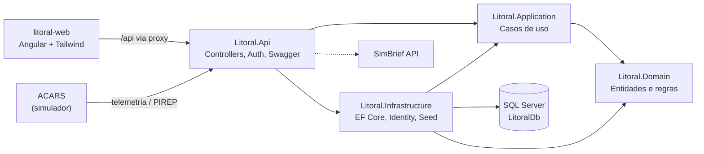

<div align="center">


# Litoral Linhas Aéreas

**Virtual Airline focada em simulação, conectando o Brasil às Américas.**

`ICAO: LTL` · `Callsign: LITORAL`


</div>

---

## Sumário

- [Sobre o projeto](#sobre-o-projeto)
- [Identidade da companhia](#identidade-da-companhia)
- [Operação](#operação)
- [Carreira do piloto](#carreira-do-piloto)
- [Estrutura de staff](#estrutura-de-staff)
- [Stack](#stack)
- [Arquitetura](#arquitetura)
- [Estrutura de pastas](#estrutura-de-pastas)
- [Como rodar o projeto](#como-rodar-o-projeto)
- [Roadmap](#roadmap)
- [Autor](#autor)

---

## Sobre o projeto

A **Litoral Linhas Aéreas** é uma companhia aérea virtual (VA) para pilotos de simulador. Voamos pelo Brasil e para destinos na América do Sul, América Central, América do Norte e Europa, com frota 100% Boeing 737.

O sistema reúne em um só lugar:

- Cadastro de pilotos e carreira (FO → CMD)
- Reserva de voos (booking) integrada ao **SimBrief**
- Acompanhamento do voo via **ACARS** e envio automático de **PIREP**
- Pontuação por desempenho, ranking e promoção automática
- Painel administrativo com permissões por posição de staff

Compatibilidade planejada com **MSFS 2020, MSFS 2024, X-Plane 11/12 e Prepar3D**, voando nas networks **IVAO** e **VATSIM**.

---

## Identidade da companhia

| | |
|---|---|
| **Nome** | Litoral Linhas Aéreas |
| **ICAO** | `LTL` |
| **Callsign (rádio)** | `LITORAL`, por exemplo *"Litoral three four one two"* |
| **Idiomas do site** | Português (padrão), English, Español, detectado pelo navegador |
| **Temas** | Claro (padrão) e escuro |

### Paleta "Costa atlântica"

| Cor | Hex | Uso |
|---|---|---|
| 🟦 Atlântico | `#1D6FD8` | Cor principal da marca |
| 🟩 Onda | `#2EC4B6` | Cor secundária e onda da cauda |
| 🟨 Sol | `#FFD166` | Destaques e badges |
| 🟥 Hibisco | `#EF476F` | Detalhes da marca |
| ⬛ Azul-marinho | `#0A1F3C` | Texto e fundo do tema escuro |
| ⬜ Areia | `#FDFCF7` | Fundo do tema claro |

### Livery

Fuselagem **branca**, cauda **azul** com a **onda turquesa** e detalhe **amarelo** no topo, e o nome "LITORAL" em azul. Cada matrícula tem uma **faixa de cor diferente** na fuselagem (Onda, Sol, Hibisco ou Pôr do sol). Essas faixas aparecem apenas nas pinturas, não no site.

---

## Operação

### Hubs

| ICAO | Cidade | Passageiros | Cargueiro |
|---|---|:---:|:---:|
| SBGR | São Paulo (Guarulhos) | ✅ | |
| SBFL | Florianópolis | ✅ | |
| SBBR | Brasília | ✅ | |
| SBEG | Manaus | ✅ | ✅ |
| SBFZ | Fortaleza | ✅ | ✅ |
| SBKP | Campinas (Viracopos) | | ✅ |

### Frota

| ICAO | Aeronave | Operação | Alcance de referência |
|---|---|---|---|
| B736 | Boeing 737-600 | Passageiros | 3.000 NM |
| B737 | Boeing 737-700 | Passageiros | 3.000 NM |
| B738 | Boeing 737-800 | Passageiros | 2.900 NM |
| B739 | Boeing 737-900ER | Passageiros | 2.900 NM |
| B38M | Boeing 737 MAX 8 | Passageiros | 3.500 NM |
| B738 | Boeing 737-800BCF | Cargueiro | 2.000 NM |

O sistema calcula a distância das rotas pelas coordenadas dos aeroportos e **não permite cadastrar uma rota maior que o alcance da aeronave**.

### Numeração dos voos

| Bloco | Uso |
|---|---|
| `1000–4999` | Doméstico (Brasil) |
| `5000–5999` | América do Sul |
| `6000–6999` | América Central e do Norte |
| `7000–7999` | Voos sazonais |
| `8000–8999` | Europa e demais destinos |
| `9000–9999` | Translado, cargueiro e callsign alternativo |

**Callsign alternativo em network:** se o callsign do voo já estiver em uso na IVAO ou na VATSIM, o piloto usa **`LTL9` + os 3 últimos dígitos do seu número de piloto**. Exemplo: piloto 1042 → `LTL9042`.

---

## Carreira do piloto

Cada piloto recebe um **número sequencial** a partir de **1000**, exibido junto da patente atual (ex.: `FO1001`, `CMD1002`). O login é feito por **e-mail e senha**.

| Patente | Requisitos |
|---|---|
| **FO**: First Officer | Todo piloto que entra na VA |
| **CMD**: Captain | **500 h** de voo **e** **30.000 pontos** |

- A promoção e o rebaixamento são **automáticos**.
- Cada voo gera pontos conforme o **desempenho** (pouso, procedimentos, desvios).
- Se um CMD ficar abaixo de **30.000 pontos**, ele volta a ser **FO**.

---

## Estrutura de staff

Todo staff também é piloto. Cada posição tem **uma única função** no sistema. Uma pessoa pode acumular mais de uma posição.

### Executive Team

| Posição | Função | Vagas |
|---|---|:---:|
| CEO & Founder | Acesso total | 1 |
| Chairman | Gestão do staff (atribuir e remover posições) | 1 |
| Vice Chairman | Substitui o Chairman, com a mesma permissão | 1 |
| General Director | Painel geral: estatísticas, relatórios e logs | 1 |

### Operations Team

| Posição | Função | Vagas |
|---|---|:---:|
| Head of HR | Gestão de pilotos: inativar, reativar e excluir | 1 |
| Director of Operations | Tours e eventos | 1 |
| Fleet Manager | Tipos de aeronave, matrículas e liveries | 1 |
| Route Manager | Rotas, aeroportos e hubs | 1 |

### Safety Team

| Posição | Função | Vagas |
|---|---|:---:|
| Safety Manager | Análise e aprovação de PIREPs | Várias |

---

## Stack

**Back-end**
- .NET 10 (LTS) / ASP.NET Core Web API
- Entity Framework Core 10 + SQL Server
- ASP.NET Core Identity + JWT
- OpenAPI + Swagger UI
- Clean Architecture

**Front-end**
- Angular 22 (standalone components e signals)
- Tailwind CSS 4
- Internacionalização própria (PT / EN / ES)
- Tema claro e escuro

**Integrações**
- SimBrief (geração e leitura de OFP)
- ACARS (em definição: smartCARS 3 via API própria ou cliente próprio com FSUIPC/XPUIPC)

---

## Arquitetura



| Camada | Responsabilidade |
|---|---|
| **Domain** | Entidades e regras de negócio: blocos de voo, callsign, alcance, patentes, staff |
| **Application** | Casos de uso: cadastro, booking, PIREP, promoção |
| **Infrastructure** | Banco de dados, Identity, migrations e seed |
| **Api** | Endpoints HTTP, autenticação e documentação |

---

## Estrutura de pastas

```
litoral-linhas-aereas/
├── src/
│   ├── Litoral.Domain/          # Entidades, enums, staff e regras
│   ├── Litoral.Application/     # Casos de uso
│   ├── Litoral.Infrastructure/  # DbContext, configurações, migrations, seed
│   └── Litoral.Api/             # Controllers, Program.cs, Swagger
├── litoral-web/                 # Front-end Angular
│   ├── public/                  # favicon e traduções (i18n)
│   └── src/app/
│       ├── core/                # serviços de idioma e tema
│       └── shared/              # componentes reutilizáveis
├── Litoral.slnx
└── package.json                 # script para rodar API + front juntos
```

---

## Como rodar o projeto

### Pré-requisitos

- [.NET SDK 10](https://dotnet.microsoft.com/download)
- [Node.js](https://nodejs.org/) 22.12+ ou 24 LTS
- SQL Server (Express, Developer ou LocalDB)
- Ferramenta de migrations do EF Core:
  ```bash
  dotnet tool install --global dotnet-ef --version 10.0.8
  ```

### Passo a passo

**1. Clone o repositório**
```bash
git clone https://github.com/alexandrefgs/litoral-linhas-aereas.git
cd litoral-linhas-aereas
```

**2. Instale as dependências do front e do script de desenvolvimento**
```bash
npm install
npm --prefix litoral-web install
```

**3. Configure a conexão com o banco** em `src/Litoral.Api/appsettings.Development.json`:
```json
{
  "ConnectionStrings": {
    "Litoral": "Server=localhost\\SQLEXPRESS;Database=LitoralDb;Trusted_Connection=True;TrustServerCertificate=True"
  }
}
```
Ajuste o `Server` conforme a sua instalação: `localhost`, `localhost\\SQLEXPRESS` ou `(localdb)\\MSSQLLocalDB`.

**4. Confie no certificado HTTPS de desenvolvimento** (uma vez só)
```bash
dotnet dev-certs https --trust
```

**5. Rode a API e o front juntos**
```bash
npm run dev
```

Em ambiente de desenvolvimento, a API **aplica as migrations e o seed automaticamente** ao iniciar: patentes, frota, aeroportos, hubs e posições de staff.

| Serviço | Endereço |
|---|---|
| Site | http://localhost:4200 |
| Swagger | https://localhost:7112/swagger |
| Health check | https://localhost:7112/api/health |

> A porta da API pode variar. Confira em `src/Litoral.Api/Properties/launchSettings.json` e, se mudar, atualize `litoral-web/proxy.conf.json`.

### Comandos úteis

| Comando | O que faz |
|---|---|
| `npm run dev` | Sobe API e front juntos |
| `npm run api` | Sobe só a API (com hot reload) |
| `npm run web` | Sobe só o front |
| `dotnet build` | Compila a solução |
| `dotnet ef migrations add Nome --project src/Litoral.Infrastructure --startup-project src/Litoral.Api --output-dir Persistence/Migrations` | Cria uma migration |

---

## Roadmap

### ✅ Fase 0: Fundação
- [x] Solução .NET 10 em Clean Architecture
- [x] Domain: aeroportos, hubs, frota, rotas, pilotos, bookings e patentes
- [x] Regras de blocos de numeração e callsign alternativo em network
- [x] Validação de alcance da aeronave por rota
- [x] Entity Framework Core + SQL Server + migrations
- [x] ASP.NET Core Identity
- [x] Seed: patentes, frota 737, aeroportos, hubs e posições de staff
- [x] Regra de promoção e rebaixamento automáticos (horas + pontos)
- [x] Swagger
- [x] Front-end Angular 22 + Tailwind CSS 4
- [x] Idiomas PT / EN / ES com detecção automática
- [x] Tema claro e escuro
- [x] Identidade visual: paleta, favicon e conceito de livery
- [x] API e front rodando juntos com `npm run dev`

### 🔜 Fase 1: Autenticação e pilotos
- [ ] Cadastro com nome, e-mail e senha
- [ ] Número de piloto automático a partir de 1000
- [ ] Primeiro usuário cadastrado vira CEO & Founder
- [ ] Login com JWT e botão Authorize no Swagger
- [ ] Telas de login e cadastro no front
- [ ] Perfil do piloto: dados, SimBrief Username, horas, pontos e patente
- [ ] Dashboard do piloto

### Fase 2: Staff e painel administrativo
- [ ] Autorização por posição de staff (policies)
- [ ] Gestão de staff, com vaga única por posição (exceto Safety Manager)
- [ ] **Head of HR:** listar, inativar, reativar e excluir pilotos
- [ ] **Route Manager:** CRUD de aeroportos, hubs e rotas
- [ ] **Fleet Manager:** tipos de aeronave, matrículas e fotos das liveries
- [ ] **General Director:** painel de estatísticas e logs
- [ ] Menu administrativo exibido conforme as posições do usuário

### Fase 3: Operações de voo
- [ ] Busca de rotas (origem, destino, aeronave, bloco)
- [ ] Booking de voo
- [ ] Sugestão de callsign alternativo `LTL9xxx`
- [ ] Integração SimBrief: abrir o dispatch já preenchido
- [ ] Integração SimBrief: importar o OFP (rota, combustível, pesos)
- [ ] Tela de briefing
- [ ] Cancelamento de booking

### Fase 4: ACARS e PIREP
- [ ] Definir o ACARS: smartCARS 3 (API compatível) ou cliente próprio (FSUIPC/XPUIPC)
- [ ] Endpoints de telemetria
- [ ] Detecção de decolagem, pouso e chegada ao gate
- [ ] PIREP automático ao final do voo
- [ ] Regras de pontuação por desempenho (pouso, desvios, penalidades)
- [ ] **Safety Manager:** fila de PIREPs pendentes com logs de telemetria
- [ ] Aprovação e rejeição de PIREP
- [ ] Soma de horas e pontos, com atualização automática da patente
- [ ] Compatibilidade com MSFS 2020/2024, X-Plane 11/12 e P3D

### Fase 5: Comunidade
- [ ] Ranking de pilotos
- [ ] **Director of Operations:** tours e eventos
- [ ] Página pública com estatísticas da VA
- [ ] Mapa de voos ao vivo
- [ ] Galeria de liveries por matrícula
- [ ] Notificações por e-mail (promoção, PIREP, inatividade)

### Fase 6: Produção
- [ ] Testes unitários do Domain
- [ ] Testes de integração da API
- [ ] CI com GitHub Actions (build e testes)
- [ ] Configuração de ambiente de produção (segredos e connection strings)
- [ ] Deploy da API, do front e do banco
- [ ] Domínio próprio e HTTPS

### 💡 Ideias futuras
- [ ] Aplicativo desktop para escolher e iniciar voos sem abrir o site
- [ ] Integração com Discord
- [ ] Estatísticas detalhadas por aeronave e por rota
- [ ] Conquistas e medalhas

---

## Autor

**Alexandre**, CEO & Founder da Litoral Linhas Aéreas

[](https://github.com/alexandrefgs)
[](https://www.linkedin.com/in/alexandre-fgs)

---

<div align="center">

*Litoral Linhas Aéreas é uma companhia aérea virtual, sem vínculo com nenhuma companhia aérea real.*

</div>