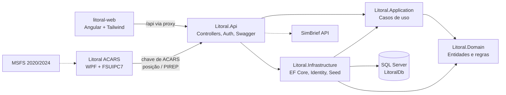

<div align="center">


# Litoral Linhas Aéreas

**Virtual Airline focada em simulação, conectando o Brasil às Américas.**

`ICAO: LTL` · `Callsign: LITORAL`


</div>

---

## Sumário

- [Sobre o projeto](#sobre-o-projeto)
- [Identidade da companhia](#identidade-da-companhia)
- [Operação](#operação)
- [Carreira do piloto](#carreira-do-piloto)
- [Perfil do piloto](#perfil-do-piloto)
- [Reserva de voos](#reserva-de-voos)
- [Briefing](#briefing)
- [Special Flights](#special-flights)
- [Tours e eventos](#tours-e-eventos)
- [Awards e Downloads](#awards-e-downloads)
- [ACARS e PIREP](#acars-e-pirep)
- [Pontos](#pontos)
- [Estatísticas e ranking](#estatísticas-e-ranking)
- [Mapa ao vivo](#mapa-ao-vivo)
- [Notificações](#notificações)
- [Segurança e privacidade](#segurança-e-privacidade)
- [Estrutura de staff](#estrutura-de-staff)
- [Stack](#stack)
- [Arquitetura](#arquitetura)
- [Estrutura de pastas](#estrutura-de-pastas)
- [Como rodar o projeto](#como-rodar-o-projeto)
- [Roadmap](#roadmap)
- [Autor](#autor)

---

## Sobre o projeto

A **Litoral Linhas Aéreas** é uma companhia aérea virtual (VA) para pilotos de simulador. Voamos pelo Brasil e para destinos na América do Sul, América Central, América do Norte e Europa, com jatos de passageiros e cargueiros. A frota é cadastrada pelo staff e pode receber novos modelos com o tempo.

O sistema reúne em um só lugar:

- **Inscrição com aprovação do RH**, que pode abrir e fechar as inscrições, e pilotos com base, carreira (FO → CMD) e **perfil público** com estatísticas e mapa de voos
- Frota com **localização real**: cada avião fica onde pousou pela última vez, com horas, ciclos e **manutenção A, C e D-check**
- Página de **aeroportos** com aeronaves no solo, partidas e **jumpseat** cobrado pela distância
- Reserva de voos aleatórios, personalizados, **escala mensal** e **Special Flights** (fretamentos, traslados, redeliveries, traslados de manutenção e voos de teste)
- **Tours** de passageiros e cargueiros com award e bônus final, e **eventos** da companhia com bônus por voo
- **MEL e CDL** com catálogo editável, itens abertos pelo staff ou pelo sistema, prazo por categoria e aeronave **AOG** quando o prazo vence
- **Awards** no perfil do piloto e **Downloads** (liveries, documentos, software) mantidos pelo staff
- Páginas públicas de **staff** e **carreira**
- Tripulação virtual: todo voo tem um segundo piloto da VA escalado
- **Briefing** com METAR/TAF, OFP e loadsheet do **SimBrief** na própria página
- Acompanhamento do voo pelo **Litoral ACARS** (app para Windows com FSUIPC7, MSFS 2020/2024), camada pronta para o **smartCARS 3** e envio automático de **PIREP**
- Pontuação por desempenho com **regras editáveis pelo staff**, revisão do Safety, promoção automática e **extrato de pontos** do piloto
- **Estatísticas** da VA e do piloto, ranking geral e **pilotos do mês** com bônus automático
- **Mapa ao vivo** no dashboard, com rota planejada, trilha voada e link para VATSIM Radar / Webeye
- **Notificações** no site (sininho) para PIREPs, bônus, promoções, inatividade, Special Flights e segurança
- **Aprovação automática** de PIREPs do ACARS com conformidade de 98% ou mais e **controle de inatividade** dos pilotos
- **Regulamento** e **Política de Privacidade** em inglês e português, com aceite registrado por versão
- **Autenticação em dois fatores** (app autenticador), obrigatória para o staff, e recursos da **LGPD**: download dos dados, pedidos de privacidade e retenção dos logs
- Painel administrativo com permissões por posição de staff, gestão de pilotos e staff, **relatórios** por período e **logs de auditoria** de tudo o que é alterado e das ações dos pilotos, com cores por gravidade

Compatibilidade planejada com **MSFS 2020, MSFS 2024, X-Plane 11/12 e Prepar3D**, voando nas networks **IVAO** e **VATSIM**.

---

## Identidade da companhia

| | |
|---|---|
| **Nome** | Litoral Linhas Aéreas |
| **ICAO** | `LTL` |
| **Callsign (rádio)** | `LITORAL`, por exemplo *"Litoral three four one two"* |
| **Idioma do site** | Inglês. Regulamento e Política de Privacidade em inglês e português |
| **Temas** | Claro (padrão), escuro ou automático pelo sistema |

### Paleta "Costa atlântica"

| Cor | Hex | Uso |
|---|---|---|
| 🟦 Atlântico | `#1D6FD8` | Cor principal da marca |
| 🟩 Onda | `#2EC4B6` | Cor secundária e onda da cauda |
| 🟨 Sol | `#FFD166` | Destaques e badges |
| 🟥 Hibisco | `#EF476F` | Detalhes da marca |
| ⬛ Azul-marinho | `#0A1F3C` | Texto e fundo do tema escuro |
| ⬜ Areia | `#FDFCF7` | Fundo do tema claro |

### Livery

Fuselagem **branca**, cauda **azul** com a **onda turquesa** e detalhe **amarelo** no topo, e o nome "LITORAL" em azul. Cada matrícula tem uma **faixa de cor diferente** na fuselagem (Onda, Sol, Hibisco ou Pôr do sol). Essas faixas aparecem apenas nas pinturas, não no site.

---

## Operação

### Aeroportos, operação e hubs

Cada aeroporto tem a **operação da Litoral** naquele local: **passageiros**, **cargueiro** ou ambos. Alguns aeroportos são marcados como **hub**.

| ICAO | Cidade | Operação | Base |
|---|---|---|:---:|
| SBGR | São Paulo (Guarulhos) | Passageiros | ✅ |
| SBFL | Florianópolis | Passageiros | ✅ |
| SBBR | Brasília | Passageiros | ✅ |
| SBEG | Manaus | Passageiros e cargueiro | ✅ |
| SBFZ | Fortaleza | Passageiros e cargueiro | ✅ |
| SBKP | Campinas (Viracopos) | Cargueiro | |

- Todos os aeroportos acima são **hubs**. Os hubs com operação de passageiros são as **bases** que o piloto pode escolher no cadastro.
- Rotas de passageiros exigem operação de passageiros nos dois aeroportos, e rotas cargueiras exigem operação de cargueiro nos dois.
- As coordenadas são cadastradas no formato do **AISWEB/ROTAER**, com ou sem espaços: `12 54 31S` / `038 19 21W` ou `125431S` / `0381921W`.
- **Busca por ICAO:** ao digitar o ICAO no cadastro, nome, cidade, país e coordenadas são preenchidos a partir do catálogo do [OurAirports](https://ourairports.com/data/) (cerca de 19 mil aeroportos), importado automaticamente na primeira execução.
- Cada aeroporto tem **código IATA** (preenchido pelo catálogo) e **foto** enviada pelo Route Manager, com campo de crédito. As fotos devem vir do **Wikimedia Commons** ou ter autorização do autor.
- **SBCF (Belo Horizonte, Confins)** é o **centro de manutenção** da Litoral: é lá que são feitos os C e D-checks.

### Acesso aos aeroportos por patente

Cada aeroporto tem uma **patente mínima**, definida pelo Route Manager no cadastro:

| Patente mínima | Quem pode operar |
|---|---|
| **FO** | Todos os pilotos |
| **CMD** | Somente comandantes |

- **Hubs são sempre FO.**
- Se um aeroporto passar a ser CMD, os FOs que estiverem nele são **movidos para a base**.
- Reservas, rotas e jumpseat mostram **apenas os aeroportos que a patente do piloto permite**.

### Frota

| ICAO | Aeronave | Operação | Alcance de referência | Matrículas |
|---|---|---|---|---|
| B738 | Boeing 737-800 | Passageiros | 2.900 NM | `PS-LA_` |
| B738 | Boeing 737-800BCF | Cargueiro | 2.000 NM | `PS-LB_` |
| B737 | Boeing 737-700 | Passageiros | 3.000 NM | `PS-LC_` |
| B739 | Boeing 737-900ER | Passageiros | 2.900 NM | `PS-LD_` |
| B38M | Boeing 737 MAX 8 | Passageiros | 3.500 NM | `PS-LE_` |
| B736 | Boeing 737-600 | Passageiros | 3.000 NM | `PS-LF_` |
| B77W | Boeing 777-300ER | Passageiros | 7.370 NM | `PS-LG_` |
| B77F | Boeing 777F | Cargueiro | 4.970 NM | `PS-LH_` |

- Os tipos de aeronave são cadastrados pelo Fleet Manager: ICAO, nome, operação, alcance, **prefixo de matrícula**, **intervalos de A, C e D-check** e **aeroporto de entrega** (de onde saem as redeliveries; 737: `KBFI`, 777: `KPAE`).
- O sistema calcula a distância das rotas pelas coordenadas dos aeroportos e **não permite cadastrar uma rota maior que o alcance da aeronave**.
- Cada aeronave tem **localização real**. Ela só pode ser reservada no aeroporto onde está, e ao fim do voo fica no destino.
- Cada aeronave acumula **horas, ciclos** e as **horas desde o último A, C e D-check**.
- Status de cada aeronave: **Disponível**, **Reservada**, **Em voo**, **Manutenção** ou **Inativa**.
- Fotos das aeronaves são enviadas manualmente, com campo de **crédito do fotógrafo**. Use apenas fotos próprias ou autorizadas.
- Cada aeronave pode ter um **SimBrief airframe ID** (o *Internal ID* de um airframe salvo, ex.: `195966_1795129909…`). Com ele, o SimBrief abre com o perfil da Litoral: pesos, equipamentos, SELCAL e motor daquela aeronave. Sem ele, vai o perfil genérico do ICAO. Veja [Link do SimBrief](#link-do-simbrief).

#### Matrículas

- Padrão da Litoral: **`PS-L` + letra do tipo + letra da sequência**. Exemplo: o primeiro B738 é `PS-LAA`, o segundo `PS-LAB`, e assim por diante.
- Ao cadastrar uma aeronave, o sistema sugere a **próxima matrícula livre** do bloco do tipo.
- Enquanto o bloco tiver vaga, só são aceitas matrículas dele. Quando o bloco **esgota**, o Fleet Manager escolhe outra matrícula livre: `PP`, `PR`, `PS`, `PT` ou `PU` + 3 letras.
- Matrículas dentro do bloco de outro tipo não são aceitas.
- Seguindo o **RBAC 45 da ANAC (45.23-I)**, são bloqueadas as combinações que começam com **Q**, que têm **W como segunda letra** e as reservadas **SOS, XXX, PAN, TTT, VFR, IFR, VMC e IMC**.

#### Manutenção

A manutenção segue os checks escalonados da aviação real. Os intervalos são **por tipo de aeronave**, em horas de voo, e podem ser editados pelo Fleet Manager.

| Check | 737 | 777 | Tempo parado | Onde é feito |
|---|---|---|---|---|
| **A-check** | 500 h | 1.000 h | 12 horas | Em qualquer **base** ou em SBCF |
| **C-check** | 5.000 h | 7.500 h | 14 dias | Somente em **SBCF** |
| **D-check** (heavy check) | 20.000 h | 25.000 h | 30 dias | Somente em **SBCF** |

- Quando dois checks vencem juntos, vale o mais pesado (D, depois C, depois A). O C-check também zera o A, e o D-check zera o C e o A.
- **Traslado automático:** ao vencer um check, se a aeronave estiver num lugar que faz aquele check, ela entra direto em manutenção. Se não estiver, o sistema cria uma Special Flight de **traslado de manutenção** com prazo de 3 dias:
  - A-check: para a **base mais próxima** dentro do alcance, aberta a qualquer patente.
  - C e D-check: para **SBCF**, somente para comandantes.
- Se ninguém fizer o traslado até o fim do prazo, ou se ele for cancelado, a aeronave é **levada até o destino** como se uma tripulação da própria companhia tivesse feito o voo, e entra em manutenção lá.
- **Voo de teste:** ao sair de um **C ou D-check**, a aeronave só volta à linha depois de um *functional check flight*: uma Special Flight com partida e pouso em SBCF, somente para comandantes, com prazo de 3 dias. Se ninguém fizer, o voo conta como feito pela tripulação da companhia.
- Uma verificação roda **a cada minuto**, então também são tratadas as aeronaves que vencem por mudança de intervalo ou que ficaram paradas.
- Se a aeronave vencer no meio de uma Special Flight de duas pernas, a perna 2 continua liberada e o check é tratado no fim.
- O Fleet Manager ainda pode mandar uma aeronave para a manutenção manualmente, com um motivo, escolhendo o retorno **manual** ou **em uma data**, e liberá-la antes do prazo.

#### MEL e CDL

A Litoral tem uma **MEL** (itens inoperantes com que a aeronave pode voar) e uma **CDL** (peças externas faltando), com textos próprios da companhia. O catálogo fica no banco e é mantido pelo **Fleet Manager** em **Admin › MEL / CDL**: criar, editar, desativar e excluir itens. Só dá para excluir um item que **nunca foi aberto**; os outros são desativados.

O catálogo inicial tem **40 itens de MEL** e **3 de CDL** para todos os tipos, e mais **11 itens de MEL do 777** (códigos `xx-71` em diante), como HF, SATCOM, gerador de backup, fuel jettison e APU com limite de 120 minutos de um alternado. Cada item tem código (ATA), título, categoria, restrição, procedimento, forma de verificação, penalidade de combustível (CDL) e tipos de aeronave (nenhum = todos).

| Categoria | Prazo |
|---|---|
| **A** | Definido no item (1 a 30 dias) |
| **B** | 3 dias |
| **C** | 10 dias |
| **D** | 120 dias |

- **Abertura pelo staff:** em **Open items**, o Fleet Manager escolhe a aeronave e o item, com uma nota opcional.
- **Abertura pelo sistema:** depois de cada voo há **3%** de chance de abrir um item, subindo até **8%** nos últimos 10% antes do próximo check. Só itens de MEL **C ou D** marcados para isso (70% C e 30% D), no máximo **2 itens do sistema** por aeronave, e nunca depois de tours ou Special Flights.
- **Prazo vencido:** a aeronave fica **AOG**. Ela some da reserva e aparece em vermelho em Open items até alguém fechar o item.
- **Fechamento:** automático quando a aeronave **pousa num hub** ou sai de uma **manutenção ou check**, ou manual pelo Fleet Manager.
- **Para o piloto:** o seletor de aeronave mostra o selo **MEL ×N** com a restrição. No Briefing, o card da aeronave tem as abas **Tech log** (itens abertos, com restrição e procedimento) e **Crew Docs** (documentos do tipo de aeronave).

**Verificação no PIREP** (só itens de MEL abertos antes do voo):

| Verificação | Como funciona |
|---|---|
| **ACARS** | **Altitude máxima** conferida automaticamente, com 300 ft de tolerância. As outras checagens (APU, autobrake, speedbrake, autothrottle, tanque central, luzes e remarks como `TCAS INOP`) já estão cadastradas e vão para o Safety até o ACARS enviar esses dados. |
| **Safety review** | O revisor marca **Followed** ou **Not followed** na revisão do PIREP. |
| **Informative** | Só informativo, sem checagem (itens D simples e toda a CDL). |

- Procedimento cumprido: **+50 pontos**. Não cumprido: **−500 pontos**. Os valores ficam na categoria **MEL & CDL** em Admin › Scoring.
- Enquanto houver item pendente, o PIREP **não é aprovado automaticamente** nem pode ser aprovado na mão.

### Numeração dos voos

| Bloco | Uso |
|---|---|
| `1000–4999` | Doméstico (Brasil) |
| `5000–5999` | América do Sul |
| `6000–6999` | América Central e do Norte |
| `7000–7999` | Tours de passageiros e voos sazonais |
| `8000–8999` | Europa e demais destinos |
| `9000–9999` | Translado, cargueiro, tours cargueiros, Special Flights e callsign alternativo |

**Sugestão de número:** no cadastro de rotas, o sistema sugere o próximo número livre do bloco, ímpar na ida e o par seguinte na volta (ex.: `LTL1003` / `LTL1004`). O bloco é escolhido pelo país e continente dos aeroportos, e rotas cargueiras sempre usam o `9xxx`.

### Rotas

As rotas são cadastradas pelo Route Manager em **Admin › Routes**. Os pilotos veem as rotas de cada aeroporto na página **Airports**.

- Cada rota tem um ou mais **tipos de aeronave** permitidos, todos de passageiros ou todos cargueiros.
- A distância precisa estar dentro do alcance de **todos** os tipos escolhidos.
- No cadastro é possível criar a **rota de volta** junto.
- Rotas com reservas não podem ser excluídas, apenas **desativadas**.
- Se o ICAO digitado não estiver cadastrado, o Route Manager pode cadastrar o aeroporto ali mesmo.

**Callsign alternativo em network:** se o callsign do voo já estiver em uso na IVAO ou na VATSIM, o piloto usa **`LTL9` + os 3 últimos dígitos do seu número de piloto**. Exemplo: piloto 1042 → `LTL9042`.

---

## Carreira do piloto

Cada piloto recebe um **número** a partir de **1000**, exibido junto da patente atual (ex.: `FO1001`, `CMD1002`). O cadastro pega sempre o **menor número livre**: o número de uma conta **excluída** volta a ficar disponível, e o de uma conta **inativa** continua reservado para ela. O login é feito por **e-mail e senha**, com **autenticação em dois fatores** opcional (obrigatória para o staff). A idade mínima é de **16 anos**, e a inscrição exige aceitar o **Regulamento** e a **Política de Privacidade**.

### Inscrição

- O botão **Apply to join** fica no fim do **Regulamento** (os links *Join Litoral* do site levam até lá). Quando as inscrições estão **fechadas**, o botão aparece desativado.
- A inscrição pede nome, e-mail, senha, base, **VATSIM e/ou IVAO ID**, **simulador**, os **add-ons de aeronaves** que o piloto tem e um texto sobre a **experiência e a motivação** (30 a 1000 caracteres).
- Enquanto espera, a pessoa pode entrar com e-mail e senha, mas só vê a tela *Application under review*. Ela ainda não tem número de piloto.
- O **Head of HR** (e o CEO) recebe uma notificação e analisa em **Admin › Applications**, com links para o perfil na VATSIM e na IVAO e o aviso quando o ID já é usado por outro piloto.
- **Aprovar:** cria o piloto como FO na base escolhida, com o próximo número livre, e leva os IDs das networks para o perfil. O resto da inscrição é apagado e o piloto é notificado.
- **Recusar:** pede um motivo (fica no log) e apaga a conta e a inscrição na hora. O e-mail fica bloqueado por **30 dias** (guardamos só um hash dele) e, se a pessoa tentar entrar, vê a data em que pode se inscrever de novo.
- No mesmo painel, o RH **abre ou fecha as inscrições**. O primeiro usuário do sistema (CEO & Founder) não passa pela aprovação.

| Patente | Requisitos |
|---|---|
| **FO**: First Officer | Todo piloto que entra na VA |
| **CMD**: Captain | **500 h** de voo **e** **30.000 pontos** |

- A promoção e o rebaixamento são **automáticos**.
- Se um CMD ficar abaixo de **30.000 pontos**, ele volta a ser **FO**.

### Base e localização

- No cadastro o piloto escolhe a sua **base** entre os hubs de passageiros.
- O piloto tem uma **localização atual**: começa na base e muda a cada voo concluído.
- **Jumpseat:** pela página **Airports**, o piloto pode se deslocar para outro aeroporto sem voar, desde que a patente permita. É **grátis para as bases** e custa **3 pontos por milha náutica** a partir de onde ele está (ex.: SBGR → SBSV = 2.352 pontos).
- **Limite:** o piloto pode fazer **um jumpseat** e **um traslado de aeronave**. Depois disso, precisa **voar pelo menos uma vez** (qualquer PIREP) para liberar os dois de novo.
- **Rebaixamento:** se o piloto estiver em um aeroporto só de CMD quando voltar a ser FO, ele é **movido automaticamente para a base**.

### Inatividade

O piloto precisa voar pelo menos uma vez a cada 40 dias. Um job diário conta os dias desde a **referência mais recente** entre o último PIREP, o cadastro e a última reativação da conta.

| Dias sem voar | O que acontece |
|---|---|
| **30** | Notificação de aviso |
| **41 a 89** | **−50 pontos por dia** até o próximo voo (lançado no extrato como *Inactivity*) |
| **90** | Conta **desativada** (notificação e log) |

- Membros do **staff** e pilotos com **voo em andamento** não são afetados.
- A conta desativada volta pelo Head of HR, e a contagem recomeça na reativação.

---

## Perfil do piloto

Cada piloto tem um perfil público em `/profile/{número}`:

- **Capa e foto:** capa padrão da companhia ou enviada pelo piloto, e foto de perfil.
- **Nome exibido:** o piloto escolhe como o nome aparece no site: `A. Fagundes` (padrão), `Alexandre F.`, nome completo, só o primeiro nome ou só o sobrenome.
- **Overview:** patente, horas, pontos, voos, gráfico de atividade por ano e mês, e as **10 rotas mais voadas**.
- **Mapa de voos:** todas as rotas já voadas pelo piloto.
- **Flights:** lista paginada de voos, com busca e ordenação. PIREPs rejeitados aparecem marcados, mantendo as horas e sem os pontos.
- **Privacidade:** e-mail, data de nascimento e Discord aparecem **só para o próprio piloto e para o staff**. A idade aparece para todos.
- **Awards:** os awards do piloto, com imagem, descrição e data (veja [Awards e Downloads](#awards-e-downloads)).
- **Downloads:** liveries, documentos e software da companhia, só para membros.

Em **Settings**, o piloto edita os dados pessoais (data de nascimento, país, estado e cidade), os IDs da **VATSIM**, da **IVAO** e do **Discord**, o **SimBrief Username**, as aeronaves que tem no simulador, a senha, a foto e a capa. Também é lá que ele ativa a **autenticação em dois fatores**, baixa os **seus dados** e faz **pedidos de privacidade** (veja [Segurança e privacidade](#segurança-e-privacidade)).

**Excluir conta:** também em Settings, o piloto pode excluir a própria conta. São duas confirmações: a primeira lista tudo o que será apagado, e a segunda (*Are you sure?*) pede a senha. A exclusão é **permanente** e apaga perfil, fotos, voos, PIREPs, flight logs, horas, pontos, escala, reservas, login e e-mail. Não é possível excluir com um voo aberto ou uma Special Flight em andamento, nem sendo do staff.

---

## Reserva de voos

O piloto sempre parte da **sua localização atual**, com uma aeronave que **esteja no aeroporto de partida**.

| Tipo | Como funciona | Custo |
|---|---|---|
| **Aleatório** | Filtro por duração (até 1 h, 1–2 h, mais de 2 h ou qualquer). O sistema sorteia a rota e uma aeronave disponível no aeroporto. Se não houver aeronave, o piloto pode trazer uma para lá sem custo. | Grátis |
| **Personalizado** | O piloto escolhe qualquer rota que saia do aeroporto onde está. | Grátis para uma base; **50 pontos** para os demais destinos |
| **Escala mensal** | Sequência de voos gerada para o mês (veja abaixo). | Grátis, com bônus |
| **Special Flight** | Fretamentos, traslados, redeliveries, traslados de manutenção e voos de teste (veja abaixo). O primeiro piloto que pegar fica com o voo. | **+300** (nacional) / **+500** (internacional) por perna |

**Escolha da aeronave:** no voo personalizado e na escala mensal, ao clicar no destino abre a tela de seleção. Ela tem a opção **Random selection** e os cards das aeronaves disponíveis no aeroporto, agrupados por tipo, com foto, matrícula, variante e último voo. No voo aleatório, a aeronave é escolhida automaticamente.

Depois da reserva, o callsign do voo aparece no menu no lugar de "Reservar voo", com a opção de cancelar. O piloto só pode ter **um voo reservado por vez**.

**Expiração:** toda reserva expira em **24 h** se o voo não for iniciado (Special Flight: no **fim da janela** definida pelo staff). A aeronave volta a ficar disponível. Na escala mensal, o voo só é reservado quando o piloto clica no card, e a contagem começa a partir daí. Se expirar, o voo continua na escala como o próximo a ser feito.

### Tripulação

Todo voo tem um **segundo piloto da VA** escalado automaticamente na reserva:

- Quem reserva é **FO** → o sistema escala um **CMD**. Quem reserva é **CMD** → o sistema escala um **FO**.
- O piloto escalado não precisa fazer nada. Ele só aparece no briefing, simulando a tripulação.
- Só pode ser escalado quem está ativo, **não tem reserva própria em aberto** e não está escalado em outro voo. Entre os livres, vai **quem foi escalado há mais tempo**.
- Se ninguém estiver livre, o voo sai com o **"Severino"**, um tripulante fictício que não recebe pontos.
- Quando o PIREP é **aprovado**, o piloto escalado ganha **10 pontos** (regra editável, sem horas de voo).
- Se o voo for cancelado ou expirar, o piloto escalado é liberado e não ganha nada. A expiração **não gera punição** para quem fez a reserva.

### Escala mensal

- Gerada na **primeira vez** que o piloto abre a página no mês.
- Tamanho: **dias restantes do mês** (incluindo hoje) **× 1, 2 ou 3 voos por dia**, à escolha do piloto.
- A escala **sempre começa e termina na base** do piloto.
- É dividida em **sequências de 5 a 7 voos**. Cada sequência termina na base, como um "tiro" da vida real, e a próxima começa de lá.
  - Exemplo: `SBFL → SBGR → SBSV → SBGR → SBFZ → SBGR → SBFL` · `SBFL → SBPA → SBCT → SBRJ → SBSP → SBFL`
  - Totais que não fecham em 5 a 7 são divididos o mais igualmente possível (ex.: 8 voos → 4 + 4). Abaixo de 5 voos, a escala tem uma sequência só. O mínimo é de 2 voos.
  - No simulador não há folga entre as sequências: ao voltar à base, a próxima já começa de lá.
- Mistura voos de **passageiros e cargueiros** (bloco `9xxx`).
- Os voos são feitos **em ordem**: só o próximo voo da escala pode ser reservado.
- Se o piloto não estiver no aeroporto de partida de um voo da escala, o card mostra a tag **Indisponível**. Ao reservar, ele faz um **jumpseat automático e sem custo** até a partida.
- Com um voo aleatório ou personalizado em aberto, a escala avisa que já existe um voo em aberto.
- Usa apenas rotas e aeroportos que a patente do piloto permite.
- Bônus de **100 pontos por voo** da escala, pago quando **todos os PIREPs da escala forem aprovados**.
- Quem terminar a escala antes do fim do mês só recebe uma nova no mês seguinte.

### Aeroportos

A página **Airports** mostra, em cards, os aeroportos que a patente do piloto permite, com foto, IATA, patente mínima (com a insígnia de FO ou CMD), pilotos no local e custo do jumpseat.

- **Aircraft:** lista as aeronaves no solo naquele aeroporto.
- **Flights:** lista as partidas daquele aeroporto, indicando se há aeronave disponível.
- **Clique no card:** faz o jumpseat para aquele aeroporto.

---

## Briefing

Com uma reserva aberta, o menu leva ao **Briefing**, uma página única com tudo o que o piloto precisa antes do voo.

**Coluna da esquerda**
- **Voo:** callsign, rota, distância e tempo, botões para atualizar (tempo e OFP) e cancelar a reserva.
- **Flight plan:** prefile na **VATSIM** e na **IVAO** (já preenchido quando o OFP está carregado) e o callsign alternativo para a network.
- **Tripulação:** cards do Captain e do First Officer.
- **Menu:** Briefing, Loadsheet e OFP, que levam à seção na página.
- **Aeronave:** foto, matrícula, modelo e último voo, com as abas **Tech log** (itens de MEL e CDL abertos) e **Crew Docs** (documentos do tipo de aeronave; o 800BCF usa os do B738).

**Seções**
- **Aeroportos:** foto, categoria do tempo (VFR, MVFR, IFR, LIFR), temperatura, vento, QNH, visibilidade (em km/m, ou SM nos EUA e no Canadá), pista e alternado do OFP, METAR, TAF e link para as cartas no ChartFox. O tempo se atualiza sozinho a cada 15 minutos.
- **SimBrief:** gerar e carregar o OFP, com resumo (nível, cost index, alternado, combustível, tempo de rota e AIRAC) e a rota.
- **Loadsheet:** passageiros, carga, pesos comparados aos limites e o combustível detalhado.
- **OFP:** o plano de voo completo exibido no próprio site, com o PDF para baixar ou abrir em nova aba.
- **Flight report:** PIREP manual e, em desenvolvimento, o simulador de voo.

Cada reserva usa um `static_id` próprio no SimBrief, e o briefing busca exatamente o OFP daquela reserva.

### Item 18 do plano de voo

Todo plano de voo da Litoral precisa ter no item 18:

```
OPR/LITORAL PIC/<ID do piloto> CS/LITORAL
```

Exemplo: `OPR/LITORAL PIC/FO1000 CS/LITORAL`. O `CS/LITORAL` faz o Aurora (IVAO) mostrar a telefonia correta. O link do SimBrief já manda esse texto, e os botões de prefile da **VATSIM** e da **IVAO** corrigem o item 18 do OFP antes de abrir. A falta do `OPR/LITORAL PIC/` reprova o PIREP (veja [Regras de pontuação](#regras-de-pontuação)).

### Link do SimBrief

O botão do SimBrief abre o despacho já preenchido para aquela reserva:

| O que vai | Valor |
|---|---|
| Voo | `airline=LTL`, número, callsign, matrícula, origem e destino |
| Aeronave (`type`) | O **airframe ID** da aeronave no SimBrief ou, se não tiver, o ICAO do tipo |
| Partida | **Agora + 45 min**, arredondado para cima de 5 em 5 minutos (UTC) |
| Tempo de bloco | O tempo estimado da rota |
| Comandante | O captain da tripulação |
| Cost index | **CI 10** nas aeronaves médias. Nas pesadas (777, 787, A330/A350...) fica com o SimBrief |
| Opções do OFP | Kg, layout **LIDO**, navlog, ETOPS, step climbs, TLR, NOTAMs, FIR NOTAMs e mapas detalhados |
| Item 18 (`acdata.extrarmk`) | `OPR/LITORAL PIC/<ID> CS/LITORAL RMK/TCAS` |
| DISP RMKS (`manualrmk`) | O item 18 e os **itens de MEL/CDL abertos** da aeronave |

Rota e combustível ficam com o SimBrief. Nos **DISP RMKS** do OFP aparece:

```
LITORAL LINHAS AEREAS - ITEM 18: OPR/LITORAL PIC/FO1000 CS/LITORAL
MEL/CDL: NIL - NO PENALTIES
```

ou, com itens abertos, uma linha por item com a penalidade de combustível (só informativa, o SimBrief não soma esse combustível):

```
MEL/CDL: MEL 21-01 PACK 1 INOP - FUEL +2.5%
```

A geração por popup (com a chave da API) usa os mesmos parâmetros.

**Perfis de airframe no SimBrief:** os perfis da Litoral ficam numa conta do SimBrief da companhia, um por tipo (ou por matrícula, se quiser um SELCAL por avião). Para cada perfil: Base Type do add-on usado, matrícula do bloco, SELCAL, layout LIDO, unidades em kg, nome `LITORAL <tipo>` e **Extra FPL Info vazio** (o item 18 vai pelo link). Depois de salvar, copie o **Internal ID** e cole em **Admin › Fleet** na aeronave.

- Se o piloto trocar de airframe na tela do SimBrief, o item 18 enviado pelo link é apagado.
- Se o airframe for excluído no SimBrief, o ID para de funcionar e precisa ser trocado no Admin.

---

## Special Flights

Voos especiais criados pelo **Director of Operations** em **Admin › Operations**, ou pelo próprio sistema no caso da manutenção. Aparecem para os pilotos na página **Special Flights**, em cards com foto, tipo, dificuldade, rota, aeronave, janela e patente mínima.

| Tipo | Uso |
|---|---|
| **Charter** | Fretamento |
| **Ferry** | Traslado de aeronave |
| **Redelivery** | Entrega de aeronave nova, saindo do aeroporto de entrega do fabricante (Boeing: `KBFI`) |
| **Maintenance ferry** | Traslado para manutenção (criado pelo sistema ou pelo staff), terminando numa base ou em SBCF |
| **Check flight** | Voo de teste após C ou D-check, com partida e pouso em SBCF (só criado pelo sistema) |

- O staff define a aeronave, **1 ou 2 pernas**, a **patente mínima** (FO ou CMD), a **dificuldade** de 1 a 5 estrelas (apenas informativa) e a janela de **Start/End em UTC**.
- Antes do Start, o card aparece bloqueado com a tag **Coming soon** e uma contagem regressiva.
- Para pegar o voo, o piloto precisa estar **no aeroporto de partida**, ter a patente mínima e não ter outro voo aberto. A perna 1 é reservada na hora. Com duas pernas, depois do PIREP da perna 1 aparece **Book leg 2**, e só quem pegou o voo pode fazê-la.
- Cada perna aprovada vale **+300** (nacional) ou **+500** (internacional).
- **Expiração:** no End, o voo expira e quem pegou perde **500 pontos**. Se a perna atual já estiver **em voo**, ela pode ser concluída e ainda vale os pontos.
- **Cancelamento:** quem cancelar perde **500 pontos**. Se nenhuma perna foi concluída, o voo volta a ficar disponível; se já foi, ele expira.
- Enquanto uma Special Flight estiver aberta ou em andamento, a aeronave fica **reservada** para ela: não aparece no Book flight, na escala mensal nem nas partidas, e não pode ser trasladada.
- Filtros **Open**, **Mine** e **History** (últimos 30 dias).

---

## Tours e eventos

Criados pelo **Director of Operations** em **Admin › Tours** e **Admin › Events**. Ficam como rascunho até serem **publicados**, e a publicação notifica os pilotos.

### Tours

Sequência de **2 a 30 pernas** que o piloto voa **em ordem**, na página **Tours**.

- **Operação:** tour de **passageiros** (pernas no bloco `7xxx`) ou **cargueiro** (bloco `9xxx`). Os tipos de aeronave permitidos valem para todas as pernas.
- Cada perna precisa partir de onde a anterior chegou. As rotas das pernas são criadas pelo próprio formulário e só servem ao tour.
- Regras: janela de datas opcional (Start/End em UTC, com **Coming soon** antes do início), **patente mínima** e **PIREP aprovado** em cada perna.
- Para reservar, o piloto precisa estar no aeroporto de partida da próxima perna (pode usar o jumpseat) e não ter outro voo aberto. A reserva usa a tela normal de escolha da aeronave.
- Cada perna dá os **pontos normais do voo**. Se o piloto pousar em outro aeroporto, a perna não conta e precisa ser voada de novo.
- Ao concluir todas as pernas, o piloto recebe o **bônus final** (*Tour bonus* no extrato) e o **award do tour**, criado junto com ele.
- Depois que algum piloto reservar uma perna, as pernas e os tipos de aeronave do tour não podem mais mudar.

### Eventos

Eventos da companhia com **janela em UTC**, até **20 aeroportos** (nenhum = qualquer aeroporto) e um **bônus fixo** de até 10.000 pontos.

- Todo voo **aprovado** que parte ou chega num aeroporto do evento dentro da janela recebe o bônus (*Event bonus* no extrato). Se o voo cair em mais de um evento, vale o de maior bônus, uma vez por PIREP.
- Os eventos em andamento e os próximos aparecem num banner no dashboard.

---

## Awards e Downloads

### Awards

- Criados pelo **Director of Operations** em **Admin › Awards**, com nome, descrição e imagem.
- Dois tipos: **manual**, concedido pelo staff a um piloto com um motivo, e **tour**, entregue automaticamente pelo sistema ao concluir o tour.
- O staff vê quem tem cada award e pode **revogar** um award manual.
- O piloto recebe uma notificação e o award aparece na aba **Awards** do perfil público.

### Downloads

- Mantidos pelo **Fleet Manager** e pelo **Director of Operations** em **Admin › Downloads**.
- Categorias **Liveries**, **Documents**, **Software** e **Other**, com tipo de aeronave opcional e versão.
- Cada item é um **arquivo** enviado (até 20 MB) ou um **link** `https://`. O site conta os downloads.
- Os pilotos baixam na aba **Downloads** do perfil. Os documentos de cada tipo de aeronave também aparecem no **Crew Docs** do Briefing.

---

## ACARS e PIREP

A API tem uma camada de ACARS **neutra**: o [Litoral ACARS](#litoral-acars-windows), o smartCARS 3 ou qualquer outro cliente só precisam usar estes endpoints.

| Etapa | Endpoint | O que acontece |
|---|---|---|
| Antes do voo | `GET /api/acars/booking` | Devolve o voo reservado (callsign, rota, aeronave e coordenadas) para o ACARS mostrar ao piloto |
| Antes do voo | `GET /api/acars/briefing` | Briefing do voo: tripulação, METAR/TAF, item 18 e links de prefile |
| Antes do voo | `GET /api/acars/briefing/ofp` | Resumo do OFP do SimBrief daquela reserva (rota, combustível e pesos) |
| Início do voo | `POST /api/acars/flight` | Cria a sessão de voo e passa a reserva e a aeronave para "em voo" |
| Durante o voo | `GET /api/acars/flight` | Sessão em andamento (para saber se o voo já foi iniciado) |
| Durante o voo | `POST /api/acars/flight/positions` | Grava a trilha (até 500 posições por lote) e a última posição para o mapa ao vivo |
| Durante o voo | `POST /api/acars/flight/network` | Troca a rede do voo (Offline, VATSIM ou IVAO). O PIREP sai com a última rede escolhida |
| Fim do voo | `POST /api/acars/flight/complete` | Recebe o resumo e os eventos, aplica as regras de pontuação e cria o PIREP como **Pending** |
| Mapa ao vivo | `GET /api/acars/live` e `GET /api/acars/live/{id}/track` | Voos em andamento e a trilha de cada um |

**Ao enviar o PIREP** (antes da revisão):
- O piloto e a aeronave vão para o **aeroporto de pouso** (ou o alternado, se divergiu).
- As **horas contam** para o piloto e a aeronave soma horas e ciclos.
- A perna da escala mensal ou da Special Flight é concluída, liberando a próxima.
- O jumpseat e o traslado de aeronave do piloto são liberados de novo.
- Se a aeronave venceu algum check, ela entra em manutenção ou ganha um traslado de manutenção (veja [Manutenção](#manutenção)).

### Litoral ACARS (Windows)

App WPF em `src/Litoral.Acars`, que lê o simulador pelo **FSUIPC7** (MSFS 2020/2024) e entra com a **chave de ACARS** do piloto (veja [Chaves de ACARS](#chaves-de-acars)). A lógica fica em `src/Litoral.Acars.Core`, que é testada sem simulador.

- **Visual:** mesma identidade do site, com barra de título própria (minimizar, maximizar e fechar), **tema claro e escuro** (salvo nas configurações) e menu lateral com **Flight**, **Briefing** e **Live map**.
- **Configuração:** endereço do servidor e chave de ACARS. A chave fica criptografada para o usuário do Windows (DPAPI) e só trafega por https (http só para o próprio PC).
- **Fluxo:** *Load flight* mostra o voo reservado, o piloto escolhe a rede (Offline, VATSIM ou IVAO), clica em *Start flight* e, depois do block on, em *File PIREP*.
- **Troca de rede:** durante o voo, basta clicar em outra rede. A troca vai para o site na hora (mapa ao vivo e PIREP) e fica no log. Depois do PIREP, a rede não muda mais.
- **Log ao vivo:** card **LOG** com cada evento na hora, em Z, com cores: marcos do voo (block off, decolagem com VR/pitch/flaps, nível de cruzeiro, toque com razão de descida, block on com distância e combustível), sistemas (motores, freio de estacionamento, trem, flaps, passagem pelos 10.000 ft, fases) e alertas (overspeed, stall, slew, crash, sim rate, **mais de 250 kt abaixo de 10.000 ft**, combustível adicionado em voo, falta de dados e falha de envio). Cada voo também é salvo em `%AppData%\Litoral ACARS\Logs\<callsign>_<data>Z.log`, com o botão **Open folder**.
- **Briefing:** a mesma página do site em versão compacta: voo, tripulação, item 18 com botão de copiar, prefile na VATSIM e na IVAO, METAR/TAF de partida e destino e o resumo do OFP do SimBrief.
- **Live map:** mapa com os voos da Litoral em andamento (o seu destacado), com tiles da CARTO no tema do app.
- **Leitura:** 4 vezes por segundo. A posição é gravada a cada 5 s, a cada 1 s abaixo de 2.500 ft AGL e a cada 30 s no portão. O lote vai para a API a cada 30 s e, se o envio falhar, fica guardado para a próxima tentativa.
- **Detecta sozinho:** block off/on, decolagem, pouso (um quique não conta), VR, pitch na decolagem, flaps na decolagem e no pouso, altura da recolhida dos flaps e da configuração de pouso, primeiro motor, nível de cruzeiro, táxi de chegada, combustível em kg e distância.
- **Fases:** Preflight, TaxiOut, Takeoff, Climb, Cruise, Descent, Approach, Landing, TaxiIn e Arrived.
- **Eventos:** overspeed, stall, slew, pausa, sim rate, crash e reabastecimento em voo, com início e duração.
- **Flaps:** tabela por tipo (737: 0/1/2/5/10/15/25/30/40; 777: 0/1/5/15/20/25/30). Tipo desconhecido não envia flaps.
- **Dados incompletos:** se a leitura do simulador parar por mais de 60 s durante o voo, o PIREP vai marcado como incompleto.
- **Alternado:** se o block on for a mais de 5 NM do destino, o app avisa para informar o aeroporto de pouso.
- **Demo flight:** com o servidor em `localhost`, grava um voo roteirizado para testar sem abrir o simulador.
- **Ainda não faz:** retomar um voo depois de fechar o app, porcentagem online e frequência do COM1 (ficam para o Safety). O histórico de trocas de rede também ainda não é guardado.

**PIREP manual:** se o ACARS falhar, o piloto envia o PIREP pelo Briefing, com comentário obrigatório. Ele **sempre passa pela revisão**.

**Simulador de voo (dev):** em ambiente de desenvolvimento, o Briefing tem o botão *Simulate flight* com três cenários (limpo, com penalidades e reprovado) para testar todo o fluxo sem o simulador.

### Revisão do Safety

Todo PIREP é revisado por um **Safety Manager** em **Admin › PIREPs**:

- Fila com abas **Pending**, **Approved**, **Rejected** e **All**, mostrando pontos e **% de conformidade**.
- Tela de revisão com dados do voo, mapa da trilha, eventos e itens de pontuação.
- O Safety pode **ignorar** um item automático (falso positivo) e **adicionar itens de revisão** (UNICOM, remarks, alternado sem justificativa, SOP...).
- **MEL:** se a aeronave voou com itens de MEL abertos, o painel **MEL items on this flight** mostra cada um. Os itens de Safety precisam ser marcados como **Followed** ou **Not followed** antes da aprovação.
- **Conformidade:** 100% menos 1% a cada 10 pontos de penalidade; qualquer item de reprovação dá 0%.
- **Aprovação automática:** PIREPs do **ACARS** com conformidade de **98% ou mais**, sem item de reprovação e de piloto **ativo** são aprovados na hora pelo sistema (o revisor aparece como *System (auto-approved)*). PIREPs manuais e os demais vão para a fila.
- O piloto recebe uma **notificação** quando o PIREP é aprovado ou rejeitado.

| Decisão | Efeito |
|---|---|
| **Aprovar** | Credita os pontos do voo, paga a tripulação, o bônus da escala mensal e o bônus da Special Flight (se for o caso) e atualiza a patente. Bloqueado enquanto houver item de reprovação ativo. |
| **Rejeitar** | Comentário obrigatório. O voo **não dá pontos** e aplica a penalidade progressiva do mês. Horas e posição da aeronave continuam valendo. |

**Penalidade por PIREP rejeitado** (por mês, editável em Admin › Scoring):

| Rejeição no mês | Penalidade |
|---|---|
| 1ª | −1.000 pontos |
| 2ª | −1.500 pontos |
| 3ª | −2.000 pontos |
| 4ª | −10.000 pontos e **conta desativada** |

Contas desativadas não conseguem reservar voos até serem reativadas pelo Head of HR. O saldo pode ficar **negativo**: o piloto continua na patente mais baixa e só é rebaixado quando fica abaixo do mínimo da patente atual.

---

## Pontos

### Regras de pontuação

As regras ficam no banco e são editadas pelo **Safety Manager** em **Admin › Scoring**: é possível alterar valores, criar, desativar e excluir regras. Os pilotos veem as regras ativas na página **Points**.

Cada regra tem uma **categoria**, um **check** (o que o sistema verifica), o resultado (**pontos** ou **reprovação**), a forma de aplicação (uma vez, por ocorrência, por segundo ou por dia), parâmetros, tipos de aeronave e carência em segundos. A tabela inicial foi criada para a Litoral:

| Categoria | Exemplos |
|---|---|
| Tempo de voo | +15 (até 1 h) a +100 (acima de 6 h), pelo block time |
| Touchdown rate | +60 (101–150 fpm) a −50 (401–500 fpm); acima de 500 fpm reprova |
| Flaps e configuração | Limites de velocidade por posição de flap (reprova); flaps certos para decolagem e pouso (+5). 737: decolagem 1/5/10/15/25 e pouso 30/40. 777: decolagem 5/15/20 e pouso 25/30 |
| Decolagem | Tailstrike por tipo (reprova: 737-800/900/MAX 11°, 737-600/700 14°, 777-300ER 10°, 777F 12,1°); VR acima de 192 kt no 737 e 195 kt no 777 (reprova) |
| Trem de pouso | 737: subir acima de 235 kt e baixar acima de 270 kt (reprova). 777: 270 kt nos dois |
| Simulador | Slew −100, stall −150, pause −50, simulation rate −600, refuel −300 |
| Procedimentos | Ordem de partida dos motores, taxi-in, motores cortados no envio do log, taxi acima de 30 kt |
| Reprovação | Offline, crash, remarks sem `OPR/LITORAL PIC/`, combustível abaixo de 4.400 kg (737) ou 12.000 kg (777) no pushback, menos de 80% online... |
| Voos especiais e eventos | Traslados e fretamentos (+300/+500), eventos IVAO/VATSIM (+500) e eventos da Litoral (+300/+500) |
| MEL & CDL | Procedimento da MEL cumprido (+50) ou não cumprido (−500) |

### Extrato

Todo movimento de pontos fica registrado no **extrato do piloto**, na aba **My statement** da página **Points** (a aba **How scoring works** mostra as regras):

- Cards com **saldo**, saldo do mês (ganho e gasto), **total ganho** e **total gasto**.
- Filtros **Flights**, **Bonuses**, **Spending**, **Penalties** e **Adjustments**.
- Lista paginada com data em UTC, descrição, pontos e o **saldo depois de cada lançamento** (sem filtro).

| Tipo | Exemplo |
|---|---|
| Pontuação do voo | Pontos do PIREP aprovado |
| Custo de reserva | Voo personalizado para fora das bases |
| Jumpseat | Deslocamento para aeroportos que não são base (3 pontos por NM) |
| Traslado de aeronave | Trazer uma aeronave para o aeroporto do piloto pela página Fleet |
| Tripulação | 10 pontos por voo aprovado em que o piloto foi escalado |
| Bônus de escala mensal | 100 pontos por voo da escala concluída |
| Piloto do mês | +800 / +600 / +400 para o pódio de horas e o de voos do mês anterior |
| Special Flight | Bônus por perna de Special Flight aprovada |
| Bônus de tour | Bônus final ao concluir todas as pernas de um tour |
| Bônus de evento | Bônus fixo por voo aprovado dentro de um evento |
| Penalidade | PIREP rejeitado, ou **−500 pontos** se uma Special Flight for cancelada ou vencer sem ser feita |
| Ajuste manual | Correção feita pelo staff |

---

## Estatísticas e ranking

A página **Statistics** reúne os números da Litoral e do piloto. Contam apenas **PIREPs aprovados**.

- **Totais da VA:** pilotos ativos, voos, horas, distância, pouso médio, aeronaves e aeroportos.
- **Suas estatísticas:** voos, horas, pontos, pouso médio e a **posição** no ranking de horas, voos e pontos.
- **Mês atual:** voos, horas e pilotos ativos da VA, os números do piloto e a posição dele nos pódios.
- **Gráfico dos últimos 12 meses**, em voos ou horas.
- **Ranking geral** (top 10) por horas, voos ou pontos, com a posição do piloto mesmo fora do top 10.
- **Top rotas, top aeroportos, uso da frota e networks.**

### Pilotos do mês

Dois pódios mensais, **Most hours** e **Most flights**, com os 10 primeiros de cada um e o card com os vencedores do mês anterior.

- Contam os PIREPs **aprovados** de **pilotos ativos** enviados no mês. Desempate: no de horas, quem tem mais voos; no de voos, quem tem mais horas.
- **Bônus por pódio:** 1º **+800**, 2º **+600** e 3º **+400**. Quem fica em 1º nos dois ganha os dois bônus.
- **Pagamento automático:** um job verifica a cada hora e paga o mês anterior assim que não sobrar nenhum PIREP pendente daquele mês, ou no máximo no **dia 3 às 00:00 UTC**, dando tempo ao Safety para revisar o fim do mês.
- O bônus entra no extrato como *Pilot of the month*, a patente é atualizada e o pagamento fica registrado nos logs (categoria **Awards**). Cada mês é pago uma única vez.

### Relatórios (General Director)

Em **Admin › Reports**, com períodos **This month**, **Last month**, **Last 90 days**, **This year** ou **Custom** (em UTC, até 2 anos):

- **Flights:** voos, horas, distância, pilotos que voaram e pouso médio.
- **PIREP reviews:** pendentes agora, o pendente mais antigo, aprovados, rejeitados, % de rejeição, conformidade média, tempo médio de revisão e PIREPs manuais.
- **Pilots:** total, ativos, inativos, novos cadastros, sem voar há 30+ dias e que nunca voaram.
- Gráfico do período (por dia até 62 dias, por mês acima disso), top pilotos por horas, networks, tipos de reserva e top rotas.

---

## Mapa ao vivo

O dashboard mostra os voos da Litoral em andamento (sessões de ACARS com posição nos últimos 10 minutos), atualizado a cada 30 segundos.

- Cada avião aparece com uma etiqueta: **callsign** e **partida ✈ destino**.
- Ao clicar, abre o painel do voo (piloto, foto da aeronave, progresso, fase, GS, altitude, distância restante, tempo para chegada e rede), com os pins **DEP** e **ARR**, a **rota planejada** tracejada e a **trilha voada** em laranja. As linhas sempre seguem o caminho mais curto, sem cruzar o planeta pelo lado errado.
- Abaixo do mapa, a tabela com todos os voos: piloto (com a **foto do perfil**, ou as iniciais se não tiver), voo e aeronave, rota com progresso, dados de voo e rede.
- A rede mostrada é a atual: se o piloto trocar de rede no ACARS durante o voo, o mapa acompanha.
- O callsign abre o voo no **VATSIM Radar** ou no **Webeye** (IVAO).
- Em desenvolvimento, o botão **Demo traffic** coloca voos fictícios no mapa para teste.

---

## Notificações

O **sininho** no topo do site mostra as notificações do piloto, com o contador de não lidas (atualizado a cada 60 segundos), as 30 mais recentes e **Mark all as read**. Cada notificação pode levar à página relacionada.

| Tipo | Quando |
|---|---|
| PIREP aprovado / rejeitado | Na revisão do Safety ou na aprovação automática |
| Bônus | Pilotos do mês, escala mensal e Special Flights |
| Promoção / rebaixamento | Mudança de patente |
| Inatividade | Aviso aos 30 dias, início da penalidade e desativação da conta |
| Special Flight | Nova Special Flight disponível para a patente do piloto |
| Tour | Novo tour publicado, perna concluída ou perna que não contou |
| Evento | Novo evento publicado |
| Award | Award recebido (manual ou por tour) |
| Reserva expirada | Reserva ou Special Flight que venceu |
| Segurança | Reset da autenticação em dois fatores pelo staff |
| Inscrição | Nova inscrição (para o RH) e inscrição aprovada (boas-vindas ao piloto) |
| Privacidade | Resposta a um pedido de privacidade |

Por enquanto as notificações são só no site. Os e-mails entram junto com o SMTP, em produção.

---

## Segurança e privacidade

### Autenticação em dois fatores (2FA)

- **App autenticador** (Google Authenticator, Microsoft Authenticator, Authy...), ativado em **Settings** com QR code ou chave manual.
- **10 códigos de recuperação** de uso único, para copiar ou baixar. Podem ser gerados de novo a qualquer momento (com senha e código).
- **Trust this device for 30 days:** o navegador guarda um marcador e não pede o código nesse período. Trocar a senha ou desativar o 2FA invalida todos os dispositivos confiáveis.
- Desativar o 2FA exige **senha e código**.
- **Obrigatório para o staff:** sem 2FA, as posições de staff não valem na API e o Admin redireciona para Settings. Pode ser desligado em desenvolvimento com `TwoFactor:RequiredForStaff = false`.
- O **Head of HR** pode **resetar** o 2FA de um piloto que perdeu o celular e os códigos (o piloto é notificado).
- **Bloqueio:** 5 erros seguidos de senha ou de código bloqueiam a conta por 5 minutos.
- Tudo fica nos logs: ativação, desativação, novos códigos, reset e o método de cada login (código, código de recuperação ou dispositivo confiável).

### Chaves de ACARS

- O ACARS da Litoral entra com uma **chave pessoal**, criada em **Settings › ACARS keys**, e nunca pede a senha nem o código do 2FA.
- A chave tem o formato `ltl_` + 64 caracteres e aparece **uma única vez**. No banco ficam só o hash SHA-256 e os primeiros caracteres.
- Até **3 chaves** por piloto, com nome, data de criação e último uso. Qualquer uma pode ser revogada.
- O app envia a chave no header `X-Acars-Key`. Ela só vale nos endpoints `/api/acars` e nunca recebe as posições de staff.
- Trocar a senha revoga todas as chaves. Conta desativada não consegue usar as suas, e excluir a conta apaga todas.
- Criação, revogação e primeiro uso ficam nos logs.

### Regulamento e Política de Privacidade

- Páginas públicas `/regulations` e `/privacy`, em **inglês e português** (`?lang=pt`), com índice e data da última atualização. Os links ficam no rodapé da home e no menu do usuário.
- A Política de Privacidade segue a **LGPD** (Lei 13.709/2018): dados coletados, bases legais, compartilhamento, armazenamento no navegador, retenção, direitos do titular e encarregado (DPO, hoje o CEO & Founder).
- **Aceite por versão:** o cadastro registra a versão aceita. Quando os textos mudam, o piloto precisa aceitar a nova versão no próximo acesso, num aviso que só fecha aceitando (ou saindo).
- Para publicar uma nova versão, atualize `LegalTerms.CurrentVersion` (`Litoral.Domain/Legal`) e `LEGAL_UPDATED_AT` (`pages/legal/legal.models.ts`) com a mesma data.

### LGPD na prática

- **Download my data:** em Settings, o piloto baixa um JSON com conta, perfil, reservas, voos, extrato de pontos, prêmios, notificações, pedidos de privacidade e o seu log de atividade.
- **Remove optional data:** o próprio piloto apaga de uma vez os dados opcionais (nascimento, localização, IDs das networks, SimBrief, aeronaves do simulador, foto e capa) sem excluir a conta.
- **Pedidos de privacidade:** para o que o piloto não resolve sozinho. Ao escolher o tipo, o formulário mostra antes o atalho que resolve na hora (download, edição em Settings, remover dados opcionais ou excluir a conta). Os tipos são acesso, correção, exclusão, portabilidade, revogação de consentimento ou outro assunto, com prazo de resposta de **15 dias** (no máximo 3 abertos por piloto). O staff responde em **Admin › Privacy**, que destaca os atrasados, e o piloto é notificado.
- **Retenção:** um job diário anonimiza os logs com mais de **2 anos** (nome, e-mail, IP e detalhes de pilotos) e apaga os pedidos de privacidade respondidos há mais de 2 anos. O prazo fica em `Privacy:AuditLogRetentionDays`.

---

## Estrutura de staff

Todo staff também é piloto. Cada posição tem **uma única função** no sistema. Uma pessoa pode acumular mais de uma posição.

As permissões são aplicadas por **policies** na API. O **CEO & Founder** acessa todas as áreas, e o menu **Admin** do site mostra a cada pessoa só as áreas das suas posições. Para usar o Admin, o staff precisa ter a **autenticação em dois fatores** ativada.

Toda ação que exige confirmação no site (aprovar ou rejeitar PIREP, desativar piloto, excluir itens, cancelar voo...) abre um **popup de confirmação** padrão.

### Executive Team

| Posição | Função | Vagas |
|---|---|:---:|
| CEO & Founder | Acesso total | 1 |
| Chairman | Gestão do staff (atribuir e remover posições) | 1 |
| Vice Chairman | Substitui o Chairman, com a mesma permissão | 1 |
| General Director | Relatórios (Reports) e logs | 1 |

### Operations Team

| Posição | Função | Vagas |
|---|---|:---:|
| Head of HR | Inscrições (aprovar, recusar, abrir e fechar), gestão de pilotos (inativar, reativar, excluir e resetar 2FA) e pedidos de privacidade | 1 |
| Director of Operations | Special Flights, tours, eventos, awards e downloads | 1 |
| Fleet Manager | Tipos de aeronave (intervalos de manutenção e aeroporto de entrega), matrículas, fotos, manutenção, MEL/CDL e downloads | 1 |
| Route Manager | Rotas, aeroportos (operação, patente mínima, hub, IATA e foto) | 1 |

### Safety Team

| Posição | Função | Vagas |
|---|---|:---:|
| Safety Manager | Análise e aprovação de PIREPs | Várias |

### Gestão de pilotos (Head of HR)

Em **Admin › Pilots**: lista com busca por nome, ID ou e-mail, abas **Active / Inactive / All**, horas, pontos, voos, último voo e posições de staff.

- **Desativar / reativar:** o piloto inativo não consegue reservar voos e mantém o número.
- **Excluir:** apaga a conta e todos os registros de forma permanente, com duas confirmações. Nos voos em que ele foi tripulação, passa a aparecer o "Severino". Horas e ciclos das aeronaves continuam, porque pertencem ao avião.
- **Reset do 2FA:** o selo **2FA** mostra quem tem a autenticação ativada, e o escudo vermelho faz o reset (também para o staff, menos o CEO e a própria conta).
- A própria conta, a do CEO e as de quem é do staff não podem ser desativadas nem excluídas por aqui.
- Em **Admin › Privacy**, o Head of HR responde os pedidos de privacidade dos pilotos.

### Gestão do staff (Chairman)

Em **Admin › Staff**, as posições aparecem por time, com quem ocupa cada uma:

- **Assign / Replace / Remove:** nas posições de vaga única, escolher outra pessoa substitui quem estava. Safety Manager aceita várias pessoas.
- **CEO & Founder** não muda; **Chairman** e **Vice Chairman** só podem ser alterados pelo CEO. Ninguém altera as próprias posições, e piloto inativo não pode entrar no staff.
- As permissões são lidas do banco a cada chamada da API: quem perde uma posição perde o acesso na hora, sem precisar sair e entrar de novo.

### Logs (General Director)

Em **Admin › Logs**, fica registrado tudo o que é alterado em contas, staff e telas de administração, além das ações dos pilotos e dos logins, com **data e hora em UTC**, categoria, ação, **quem fez**, **em quem ou em quê**, os detalhes e o **IP**. Depois de **2 anos**, os dados pessoais dos logs são anonimizados.

- As alterações feitas pelo Admin, pelo Settings do piloto e pelo cadastro são registradas automaticamente, com **valor antigo → novo**. Itens criados ou excluídos guardam todos os campos.
- Troca de senha, posições do staff e exclusão de conta também são registradas. Nome, e-mail e números ficam salvos no log, então ele continua legível depois que a conta é excluída.
- Cada log tem uma **cor pela gravidade**: 🔴 **Critical** (exclusões, contas excluídas ou desativadas, PIREP rejeitado, mudanças de staff e reset de 2FA), 🟡 **Important** (alterações, reativação, troca de senha, logins com erro, 2FA desativado e pedidos de privacidade) e 🟢 **Routine** (criações, aprovações e bônus).
- Filtro **Critical only**, categorias (Accounts, Pilots, Staff, PIREPs, Scoring, Fleet, Routes, Airports, Operations, Tours, Events, Awards, Downloads, Bookings, Logins e Privacy) e busca por ação, piloto, item ou detalhe.
- **Bookings:** reservas, cancelamentos, expirações, jumpseat e traslados de aeronave. **Logins:** entradas e tentativas com senha ou código errado, com o método usado.
- Os jobs (pilotos do mês, inatividade, aprovação automática e retenção) aparecem como feitos pelo **System**, e as ações sem login como **Visitor**.


### Monitor do sistema (CEO)

Em **Admin › System**, só para o CEO & Founder, atualizado a cada 30 segundos:

- **API:** versão, ambiente, runtime, uptime e memória. **Banco:** conexão, latência, tamanho e migrations pendentes.
- **Tráfego:** requisições e erros 5xx por minuto na última hora, tempo médio de resposta e totais desde o início.
- **Integrações:** METAR, SimBrief e OurAirports, com chamadas, falhas, latência, último sucesso e último erro.
- **Jobs:** cada job em background com intervalo, última execução, duração, próxima execução e estado (**Ok**, **Running**, **Late** ou **Failing**).
- **Números da operação:** voos em andamento, sessões de ACARS ao vivo, reservas, PIREPs pendentes, aeronaves em manutenção e AOG, pilotos ativos, inscrições e pedidos de privacidade.
- **Erros recentes:** os últimos 50 erros 500, com rota, horário, tipo, mensagem e trace id (sem stack trace).
- **Armazenamento:** espaço e arquivos das pastas de uploads e downloads.

As métricas ficam em memória e recomeçam quando a API reinicia.

---

## Stack

**Back-end**
- .NET 10 (LTS) / ASP.NET Core Web API
- Entity Framework Core 10 + SQL Server
- ASP.NET Core Identity + JWT, com 2FA (TOTP) e Data Protection
- OpenAPI + Swagger UI
- Clean Architecture

**Front-end**
- Angular 22 (standalone, signals e zoneless)
- Tailwind CSS 4
- Leaflet + mapas CARTO
- Tabler Icons
- qrcode (QR do app autenticador)
- Tema claro, escuro e automático

**ACARS (desktop)**
- WPF (.NET 10) para Windows
- FSUIPCClientDLL (FSUIPC7) para ler o MSFS 2020/2024
- DPAPI para guardar a chave de ACARS
- WebView2 + Leaflet + CARTO no mapa ao vivo

**Testes**
- xUnit
- WebApplicationFactory + Testcontainers (SQL Server)

**Integrações**
- SimBrief (link de despacho por reserva com airframe salvo, item 18 e MEL/CDL, leitura do OFP, PDF e geração por popup com a API)
- aviationweather.gov (METAR e TAF)
- **ChartFox**: link para as cartas de cada aeroporto
- **FSUIPC7**: leitura do simulador pelo Litoral ACARS
- **smartCARS 3** (planejado): a API do Litoral vai implementar a [especificação REST](https://github.com/invernyx/smartcars-3-phpvms5-api/blob/development/openapi.json) usada pelo app, em .NET, sem PHP
- **OurAirports**: catálogo de aeroportos para a busca por ICAO
- **Wikimedia Commons**: origem recomendada das fotos de aeroportos, com crédito do autor
- **VATSIM Radar** e **IVAO Webeye**: links para acompanhar o voo na rede

---

## Arquitetura



| Camada | Responsabilidade |
|---|---|
| **Domain** | Entidades e regras de negócio: blocos de voo, callsign, alcance, patentes, base, localização, frota, checks de manutenção, Special Flights, pontos e staff |
| **Application** | Contratos e casos de uso: cadastro, perfil, booking, aeroportos, Special Flights, ACARS, PIREP, revisão, pontuação e estatísticas |
| **Infrastructure** | Banco de dados, Identity, JWT, migrations, seed, armazenamento de fotos, logs de auditoria (interceptor do EF Core) e jobs em segundo plano (expiração de reservas e Special Flights, manutenção, pagamento dos pilotos do mês, inatividade e retenção de dados) |
| **Api** | Endpoints HTTP, tratamento de erros e documentação |
| **Acars.Core** | Conversão dos offsets do FSUIPC, gravador do voo (fases, eventos e resumo), log do voo, tabela de flaps, formatação do briefing, mensagens do mapa e cliente da API |
| **Acars** | App WPF: leitura do FSUIPC7, telas Flight, Briefing e Live map, temas claro e escuro, arquivo de log e configurações |

---

## Estrutura de pastas

```
litoral-linhas-aereas/
├── src/
│   ├── Litoral.Domain/          # Entidades, enums, staff e regras
│   ├── Litoral.Application/     # Contratos e casos de uso
│   ├── Litoral.Infrastructure/  # DbContext, configurações, migrations, seed, auth
│   ├── Litoral.Api/             # Controllers, Program.cs e Swagger
│   ├── Litoral.Acars.Core/      # Lógica do ACARS: FSUIPC, gravador do voo e cliente da API
│   └── Litoral.Acars/           # App WPF do Litoral ACARS (Windows)
├── tests/
│   ├── Litoral.Domain.Tests/          # Motor de pontuação, chaves de ACARS, item 18, link do SimBrief e airframe
│   ├── Litoral.Acars.Tests/           # Conversões, gravador e log do voo, briefing, mapa e cliente do ACARS
│   └── Litoral.Api.IntegrationTests/  # API com SQL Server no Testcontainers
├── litoral-web/                 # Front-end Angular
│   ├── public/                  # favicon, insígnias das patentes e logos das networks
│   └── src/app/
│       ├── core/                # auth, api, admin, staff, tema, dados de referência, config
│       ├── shared/              # header, mapas, gráficos, popup de confirmação, seletor de data, pipes e utilitários
│       └── pages/               # home, login, cadastro, regulamento e privacidade, dashboard, perfil, aeroportos, reserva, special flights, briefing, voo, frota, pontos, estatísticas e admin
├── uploads/                     # fotos enviadas (pilotos, aeronaves, aeroportos, special flights), fora do Git
├── Litoral.slnx
└── package.json                 # script para rodar API + front juntos
```

---

## Como rodar o projeto

### Pré-requisitos

- [.NET SDK 10](https://dotnet.microsoft.com/download)
- [Node.js](https://nodejs.org/) 22.12+ ou 24 LTS
- SQL Server (Express, Developer ou LocalDB)
- Ferramenta de migrations do EF Core:
  ```bash
  dotnet tool install --global dotnet-ef --version 10.0.8
  ```

### Passo a passo

**1. Clone o repositório**
```bash
git clone https://github.com/alexandrefgs/litoral-linhas-aereas.git
cd litoral-linhas-aereas
```

**2. Instale as dependências do front e do script de desenvolvimento**
```bash
npm install
npm --prefix litoral-web install
```

**3. Configure a conexão com o banco** em `src/Litoral.Api/appsettings.Development.json`:
```json
{
  "ConnectionStrings": {
    "Litoral": "Server=localhost\\SQLEXPRESS;Database=LitoralDb;Trusted_Connection=True;TrustServerCertificate=True"
  }
}
```
Ajuste o `Server` conforme a sua instalação: `localhost`, `localhost\\SQLEXPRESS` ou `(localdb)\\MSSQLLocalDB`.

**4. Configure a chave do mapa** em `litoral-web/src/app/core/config/app-config.ts`.
Os mapas usam tiles da [CARTO](https://carto.com/), que exigem uma chave gratuita. A chave do repositório funciona apenas em `localhost`; para outro domínio, crie a sua.

**5. (Opcional) Configure a chave da API do SimBrief**
Sem a chave, o briefing usa o botão *Generate on SimBrief* (nova aba). Com a chave, o OFP é gerado num popup sem sair do briefing. Guarde a chave nos user-secrets, nunca no `appsettings`:
```bash
dotnet user-secrets set "SimBrief:ApiKey" "SUA_CHAVE" --project src/Litoral.Api
```
O endereço de retorno do popup fica em `SimBrief:OutputPage` no `appsettings.json` (em desenvolvimento, `http://localhost:4200/simbrief-return.html`).

**6. Confie no certificado HTTPS de desenvolvimento** (uma vez só)
```bash
dotnet dev-certs https --trust
```

**7. Rode a API e o front juntos**
```bash
npm run dev
```

As fotos enviadas ficam na pasta `uploads/` na raiz do repositório (configurável em `Storage:UploadsPath`), fora do projeto da API, para o `dotnet watch` não reiniciar a cada upload. Ela é servida em `/uploads` e não vai para o Git.

Em ambiente de desenvolvimento, a API **aplica as migrations e o seed automaticamente** ao iniciar: patentes, tipos de aeronave com prefixo de matrícula, aeroportos, hubs e posições de staff. Na primeira execução, ela também importa o catálogo de aeroportos do OurAirports, o que leva alguns segundos. O **primeiro usuário cadastrado** vira CEO & Founder. Para abrir o Admin, ative antes a **autenticação em dois fatores** em Settings.

| Serviço | Endereço |
|---|---|
| Site | http://localhost:4200 |
| Swagger | https://localhost:7112/swagger |
| Health check | https://localhost:7112/api/health |

> A porta da API pode variar. Confira em `src/Litoral.Api/Properties/launchSettings.json` e, se mudar, atualize `litoral-web/proxy.conf.json`.

### Litoral ACARS

Precisa de Windows, do **MSFS 2020 ou 2024** e do **FSUIPC7** abertos.

1. No site, crie uma chave em **Settings › ACARS keys** e reserve um voo.
2. Rode o app:
   ```bash
   dotnet run --project src/Litoral.Acars
   ```
3. Em **Connection**, informe o servidor (`https://localhost:7112` em desenvolvimento), cole a chave e clique em **Save**.
4. Clique em **Load flight**, escolha a rede e clique em **Start flight** com a aeronave no portão.

Sem simulador, com a API em `localhost`, o botão **Demo flight** grava um voo roteirizado para testar o fluxo inteiro. As configurações ficam em `%AppData%\Litoral ACARS\settings.json`, com a chave criptografada, e os logs dos voos em `%AppData%\Litoral ACARS\Logs`.

**Mapa ao vivo do ACARS:** precisa do **WebView2 Runtime** (já vem no Windows 10/11 atualizado). A página do mapa é servida no domínio local `acars.localhost` (`MapTiles.Host`). Coloque a chave da CARTO em `src/Litoral.Acars/Map/MapSettings.cs` e libere esse domínio na chave, no painel da CARTO. Sem chave, o mapa usa os tiles do OpenStreetMap.

### Testes

```bash
dotnet test
```
Os testes de integração sobem um SQL Server no **Docker** (Testcontainers), então o Docker Desktop precisa estar aberto. A primeira execução baixa a imagem e demora alguns minutos.

### Comandos úteis

| Comando | O que faz |
|---|---|
| `npm run dev` | Sobe API e front juntos |
| `npm run api` | Sobe só a API (com hot reload) |
| `npm run web` | Sobe só o front |
| `dotnet build` | Compila a solução |
| `dotnet test` | Roda os testes de Domain, ACARS e integração |
| `dotnet run --project src/Litoral.Acars` | Abre o Litoral ACARS |
| `dotnet ef migrations add Nome --project src/Litoral.Infrastructure --startup-project src/Litoral.Api --output-dir Persistence/Migrations` | Cria uma migration |

---

## Roadmap

### ✅ Fase 0: Fundação
- [x] Solução .NET 10 em Clean Architecture
- [x] Domain: aeroportos, hubs, frota, rotas, pilotos, bookings e patentes
- [x] Regras de blocos de numeração e callsign alternativo em network
- [x] Validação de alcance da aeronave por rota
- [x] Entity Framework Core + SQL Server + migrations
- [x] ASP.NET Core Identity
- [x] Seed: patentes, frota (737 e 777), aeroportos, hubs e posições de staff
- [x] Regra de promoção e rebaixamento automáticos (horas + pontos)
- [x] Swagger
- [x] Front-end Angular 22 + Tailwind CSS 4
- [x] Site em inglês (Regulamento e Privacidade também em português)
- [x] Tema claro, escuro e automático
- [x] Identidade visual: paleta, favicon e conceito de livery
- [x] API e front rodando juntos com `npm run dev`

### ✅ Fase 1: Autenticação, pilotos e site público
- [x] Cadastro com nome, e-mail, senha e escolha da base (hoje, inscrição aprovada pelo RH)
- [x] Número de piloto automático a partir de 1000
- [x] Primeiro usuário cadastrado vira CEO & Founder
- [x] Login com JWT e botão Authorize no Swagger
- [x] Telas de login e cadastro
- [x] Perfil do piloto com SimBrief Username
- [x] Dashboard do piloto: mapa, patente, horas, pontos e progresso para CMD
- [x] Site público: início, sobre, operação, números e últimos voos
- [x] Menu com NOTAMs e notícias
- [x] Redirecionamento: piloto logado vai para o dashboard, visitante vê a home

### ✅ Fase 2: Regras de operação, staff e cadastros
- [x] Frota com matrícula, variante, foto e localização real
- [x] Boeing 777-300ER e 777F, com regras de pontuação e itens de MEL próprios
- [x] Extrato de pontos (ledger)
- [x] Patente mínima por aeroporto (FO ou CMD)
- [x] Base do piloto e retorno automático à base no rebaixamento
- [x] Jumpseat respeitando a patente
- [x] Autorização por posição de staff (policies)
- [x] Área administrativa com menu conforme as posições do usuário
- [x] **Route Manager:** aeroportos (operação, FO/CMD, hub e coordenadas AISWEB)
- [x] Busca de aeroporto por ICAO (catálogo OurAirports)
- [x] **Route Manager:** rotas com vários tipos de aeronave, rota de volta e sugestão do número do voo
- [x] Cadastro de aeroporto direto do formulário de rota quando o ICAO não existe
- [x] **Fleet Manager:** tipos de aeronave com prefixo de matrícula, intervalos de A, C e D-check e aeroporto de entrega
- [x] **Fleet Manager:** aeronaves com matrícula sugerida por bloco, regras da ANAC, foto com crédito e localização
- [x] **Fleet Manager:** manutenção manual ou com data de retorno automática, ativar e desativar
- [x] Manutenção automática por horas ao concluir o voo
- [x] Checks A (bases, 12 h), C (SBCF, 14 dias) e D (SBCF, 30 dias)
- [x] Centro de manutenção em SBCF com traslado automático de manutenção
- [x] Voo de teste (check flight) após C e D-check
- [x] **Route Manager:** IATA e foto com crédito nos aeroportos
- [x] **Fleet Manager:** MEL/CDL com catálogo editável, abertura pelo staff ou pelo sistema, AOG no vencimento e verificação no PIREP
- [x] **Chairman:** gestão de staff, com vaga única por posição (exceto Safety Manager) e permissões aplicadas na hora
- [x] **Head of HR:** listar, desativar, reativar e excluir pilotos
- [x] Exclusão permanente de conta (pelo staff ou pelo próprio piloto) com dupla confirmação
- [x] Reaproveitamento do número de piloto de contas excluídas
- [x] **General Director:** logs de auditoria de contas, staff e ações do staff, com antes → depois e IP
- [x] Cores por gravidade nos logs e filtro Critical only
- [x] Logs de ações dos pilotos (reservas, jumpseat, voos) e logins com IP
- [x] Confirmações do site todo no estilo popup (componente `ConfirmDialog`)

### ✅ Fase 2B: Páginas do piloto
- [x] Aeroportos em cards, com aeronaves no solo, partidas e jumpseat (grátis para bases, 3 pontos por NM para os demais)
- [x] Limite de um jumpseat e um traslado de aeronave até o próximo voo
- [x] Frota, com localização e status de cada matrícula
- [x] Special Flights no lugar da antiga página de rotas
- [x] Tabela de regras de pontuação (página Points)
- [x] Extrato de pontos (My statement) com filtros e saldo por lançamento
- [x] Estatísticas do piloto
- [x] Perfil do piloto: capa, foto, overview, gráfico de atividade, top 10 rotas, mapa de voos e lista de voos
- [x] Settings: dados pessoais, VATSIM/IVAO/Discord, SimBrief, aeronaves do simulador, senha e formato do nome
- [x] Awards no perfil e downloads (liveries, documentos e software)
- [x] Tech log e Crew Docs no card da aeronave do Briefing
- [x] Regulamento e Política de Privacidade (inglês e português)

### ✅ Fase 3: Reserva de voos
- [x] Voo aleatório com filtro de duração
- [x] Voo personalizado (custo de 50 pontos fora das bases)
- [x] Escala mensal (passageiros e cargueiros) com sequências de 5 a 7 voos começando e terminando na base, com jumpseat automático até a partida
- [x] Tela de escolha da aeronave (Random selection ou card por matrícula), no voo personalizado e na escala mensal
- [x] Translado de aeronave sem custo
- [x] Escala automática do segundo piloto (FO ↔ CMD)
- [x] Confirmação da reserva e callsign no menu
- [x] Briefing: SimBrief, METAR e prefile
- [x] Cancelamento e expiração da reserva em 24 h
- [x] Briefing em página única: prefile VATSIM/IVAO, tripulação, aeroportos com METAR/TAF decodificados, card da aeronave e menu lateral
- [x] OFP do SimBrief exibido no site (texto), com PDF para baixar ou abrir em nova aba
- [x] Loadsheet: pesos contra os limites e combustível detalhado
- [x] Tempo atualizado sozinho a cada 15 minutos
- [ ] Geração do OFP em popup pela API do SimBrief (aguardando a chave de API)

### ✅ Fase 3B: Special Flights
- [x] **Director of Operations:** Charter, Ferry, Redelivery e Maintenance ferry com 1 ou 2 pernas, patente mínima, dificuldade, foto e janela em UTC
- [x] Página do piloto com Coming soon, Take flight, Book leg 2 e filtros Open, Mine e History
- [x] Bônus por perna (+300 nacional / +500 internacional), expiração no fim da janela e −500 pontos se vencer ou for cancelada
- [x] Aeronave reservada enquanto a Special Flight estiver aberta

### 🔜 Fase 4: ACARS e PIREP
- [x] Camada de ACARS neutra: voo reservado, início do voo, posições, eventos e conclusão
- [x] Chave pessoal de ACARS (Settings), aceita só nos endpoints de ACARS
- [x] **Litoral ACARS v0** (Windows, FSUIPC7, MSFS 2020/2024) com trilha, eventos e PIREP automático
- [x] Visual do site no ACARS: barra de título própria, tema claro/escuro e menu com Flight, Briefing e Live map
- [x] Log ao vivo no ACARS, salvo em arquivo por voo
- [x] Troca de rede durante o voo
- [x] Link do SimBrief por reserva: airframe salvo, partida +45 min, CI 10 nas médias, item 18 e MEL/CDL nos DISP RMKS
- [x] Item 18 `OPR/LITORAL PIC/<ID> CS/LITORAL` no SimBrief e nos prefiles da VATSIM e da IVAO
- [ ] Retomar um voo depois de fechar o Litoral ACARS
- [ ] Porcentagem online (feed da VATSIM/IVAO) e checagem da frequência do COM1
- [x] Trilha do voo e última posição gravadas por sessão
- [x] Motor de pontuação com regras editáveis (Admin › Scoring) e % de conformidade
- [x] PIREP automático ao final do voo e PIREP manual (sempre revisado)
- [x] Simulador de voo para desenvolvimento (três cenários)
- [x] Página do voo com tripulação, aeronave, mapa, perfil do voo, flight log e pontuação
- [x] **Safety Manager:** fila de revisão, itens de revisão manuais e falsos positivos
- [x] Aprovação e rejeição de PIREP com penalidade progressiva no mês e desativação de conta
- [x] Horas, localização da aeronave e do piloto, patente, tripulação e bônus da escala mensal
- [ ] API compatível com o **smartCARS 3** (`api/smartcars`) usando a camada de ACARS
- [ ] Cadastro da comunidade no smartCARS Central
- [ ] Callsign real usado na network gravado na sessão
- [x] Aprovação automática de PIREPs com conformidade ≥ 98%
- [x] Notificação ao piloto quando o PIREP for revisado
- [ ] Compatibilidade com X-Plane 11/12 e P3D

### 🔜 Fase 5: Estatísticas e comunidade
- [x] Estatísticas do piloto e da VA
- [x] **General Director:** relatórios por período (Reports)
- [x] Ranking de pilotos e pilotos do mês (+800/+600/+400) com pagamento automático
- [x] Jobs de conta: aviso aos 30 dias, −50 por dia a partir do 41º e desativação aos 90
- [x] Notificações no site (sininho)
- [x] Páginas públicas de staff e carreira
- [x] **Director of Operations:** tours de passageiros e cargueiros (com award e bônus final) e eventos com bônus por voo
- [x] Mapa de voos ao vivo no dashboard, com rota planejada, trilha voada e links para VATSIM Radar / Webeye
- [ ] Galeria de liveries por matrícula
- [ ] Notificações por e-mail (promoção, PIREP, inatividade)

### ✅ Fase 5B: Segurança e privacidade
- [x] Autenticação em dois fatores (app autenticador), códigos de recuperação e dispositivo confiável por 30 dias
- [x] 2FA obrigatório para o staff e reset pelo Head of HR
- [x] Bloqueio após 5 tentativas erradas
- [x] Aceite do Regulamento e da Privacidade por versão, com novo aceite quando mudarem
- [x] Download dos dados do piloto (LGPD)
- [x] Pedidos de privacidade com prazo de 15 dias (Settings e Admin › Privacy)
- [x] Retenção de 2 anos nos logs, com anonimização automática
- [x] Inscrição com aprovação do Head of HR e abertura/fechamento das inscrições
- [x] Remoção dos dados opcionais pelo próprio piloto
- [ ] Código do 2FA por e-mail (depende do SMTP)

### 🔜 Fase 6: Produção
- [x] Monitor do sistema para o CEO (saúde da API e do banco, tráfego, integrações, jobs, erros e armazenamento)
- [x] Testes unitários do Domain (motor de pontuação, chaves de ACARS, item 18, link do SimBrief e airframe) e do ACARS (conversões do FSUIPC, gravador e log do voo, briefing, mapa e cliente da API)
- [x] Testes de integração da API com Testcontainers (fluxo de ACARS, chaves e voo completo pelo cliente do Litoral ACARS)
- [ ] CI com GitHub Actions (build e testes)
- [ ] Configuração de ambiente de produção (segredos, connection strings, chave CARTO e chaves do Data Protection)
- [ ] Trava que impede subir em produção com a chave JWT de desenvolvimento
- [ ] Deploy da API, do front e do banco
- [ ] Domínio próprio e HTTPS

### 💡 Ideias futuras
- [ ] Aplicativo desktop para escolher e iniciar voos sem abrir o site
- [ ] Integração com Discord
- [ ] Estatísticas detalhadas por aeronave e por rota
- [ ] Checagens automáticas da MEL pelo ACARS (APU, autobrake, luzes, remarks...)

---

## Autor

**Alexandre**, CEO & Founder da Litoral Linhas Aéreas

[](https://github.com/alexandrefgs)
[](https://www.linkedin.com/in/alexandre-fgs)

---

<div align="center">

*Litoral Linhas Aéreas é uma companhia aérea virtual, sem vínculo com nenhuma companhia aérea real.*

</div>