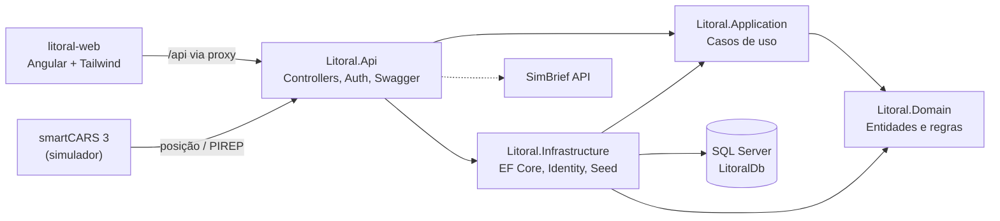

<div align="center">


# Litoral Linhas Aéreas

**Virtual Airline focada em simulação, conectando o Brasil às Américas.**

`ICAO: LTL` · `Callsign: LITORAL`


</div>

---

## Sumário

- [Sobre o projeto](#sobre-o-projeto)
- [Identidade da companhia](#identidade-da-companhia)
- [Operação](#operação)
- [Carreira do piloto](#carreira-do-piloto)
- [Perfil do piloto](#perfil-do-piloto)
- [Reserva de voos](#reserva-de-voos)
- [Special Flights](#special-flights)
- [ACARS e PIREP](#acars-e-pirep)
- [Pontos](#pontos)
- [Mapa ao vivo](#mapa-ao-vivo)
- [Estrutura de staff](#estrutura-de-staff)
- [Stack](#stack)
- [Arquitetura](#arquitetura)
- [Estrutura de pastas](#estrutura-de-pastas)
- [Como rodar o projeto](#como-rodar-o-projeto)
- [Roadmap](#roadmap)
- [Autor](#autor)

---

## Sobre o projeto

A **Litoral Linhas Aéreas** é uma companhia aérea virtual (VA) para pilotos de simulador. Voamos pelo Brasil e para destinos na América do Sul, América Central, América do Norte e Europa, com frota 100% Boeing 737.

O sistema reúne em um só lugar:

- Cadastro de pilotos, base, carreira (FO → CMD) e **perfil público** com estatísticas e mapa de voos
- Frota com **localização real**: cada avião fica onde pousou pela última vez, com horas, ciclos e **manutenção A, C e D-check**
- Página de **aeroportos** com aeronaves no solo, partidas e **jumpseat** cobrado pela distância
- Reserva de voos aleatórios, personalizados, **escala mensal** e **Special Flights** (fretamentos, traslados, redeliveries, traslados de manutenção e voos de teste)
- Tripulação virtual: todo voo tem um segundo piloto da VA escalado
- Briefing integrado ao **SimBrief**
- Acompanhamento do voo via **ACARS** (camada pronta para o **smartCARS 3**) e envio automático de **PIREP**
- Pontuação por desempenho com **regras editáveis pelo staff**, revisão do Safety e promoção automática
- **Mapa ao vivo** no dashboard, com rota planejada, trilha voada e link para VATSIM Radar / Webeye
- Painel administrativo com permissões por posição de staff

Compatibilidade planejada com **MSFS 2020, MSFS 2024, X-Plane 11/12 e Prepar3D**, voando nas networks **IVAO** e **VATSIM**.

---

## Identidade da companhia

| | |
|---|---|
| **Nome** | Litoral Linhas Aéreas |
| **ICAO** | `LTL` |
| **Callsign (rádio)** | `LITORAL`, por exemplo *"Litoral three four one two"* |
| **Idioma do site** | Inglês. Regulamento e Política de Privacidade em inglês e português |
| **Temas** | Claro (padrão), escuro ou automático pelo sistema |

### Paleta "Costa atlântica"

| Cor | Hex | Uso |
|---|---|---|
| 🟦 Atlântico | `#1D6FD8` | Cor principal da marca |
| 🟩 Onda | `#2EC4B6` | Cor secundária e onda da cauda |
| 🟨 Sol | `#FFD166` | Destaques e badges |
| 🟥 Hibisco | `#EF476F` | Detalhes da marca |
| ⬛ Azul-marinho | `#0A1F3C` | Texto e fundo do tema escuro |
| ⬜ Areia | `#FDFCF7` | Fundo do tema claro |

### Livery

Fuselagem **branca**, cauda **azul** com a **onda turquesa** e detalhe **amarelo** no topo, e o nome "LITORAL" em azul. Cada matrícula tem uma **faixa de cor diferente** na fuselagem (Onda, Sol, Hibisco ou Pôr do sol). Essas faixas aparecem apenas nas pinturas, não no site.

---

## Operação

### Aeroportos, operação e hubs

Cada aeroporto tem a **operação da Litoral** naquele local: **passageiros**, **cargueiro** ou ambos. Alguns aeroportos são marcados como **hub**.

| ICAO | Cidade | Operação | Base |
|---|---|---|:---:|
| SBGR | São Paulo (Guarulhos) | Passageiros | ✅ |
| SBFL | Florianópolis | Passageiros | ✅ |
| SBBR | Brasília | Passageiros | ✅ |
| SBEG | Manaus | Passageiros e cargueiro | ✅ |
| SBFZ | Fortaleza | Passageiros e cargueiro | ✅ |
| SBKP | Campinas (Viracopos) | Cargueiro | |

- Todos os aeroportos acima são **hubs**. Os hubs com operação de passageiros são as **bases** que o piloto pode escolher no cadastro.
- Rotas de passageiros exigem operação de passageiros nos dois aeroportos, e rotas cargueiras exigem operação de cargueiro nos dois.
- As coordenadas são cadastradas no formato do **AISWEB/ROTAER**, com ou sem espaços: `12 54 31S` / `038 19 21W` ou `125431S` / `0381921W`.
- **Busca por ICAO:** ao digitar o ICAO no cadastro, nome, cidade, país e coordenadas são preenchidos a partir do catálogo do [OurAirports](https://ourairports.com/data/) (cerca de 19 mil aeroportos), importado automaticamente na primeira execução.
- Cada aeroporto tem **código IATA** (preenchido pelo catálogo) e **foto** enviada pelo Route Manager, com campo de crédito. As fotos devem vir do **Wikimedia Commons** ou ter autorização do autor.
- **SBCF (Belo Horizonte, Confins)** é o **centro de manutenção** da Litoral: é lá que são feitos os C e D-checks.

### Acesso aos aeroportos por patente

Cada aeroporto tem uma **patente mínima**, definida pelo Route Manager no cadastro:

| Patente mínima | Quem pode operar |
|---|---|
| **FO** | Todos os pilotos |
| **CMD** | Somente comandantes |

- **Hubs são sempre FO.**
- Se um aeroporto passar a ser CMD, os FOs que estiverem nele são **movidos para a base**.
- Reservas, rotas e jumpseat mostram **apenas os aeroportos que a patente do piloto permite**.

### Frota

| ICAO | Aeronave | Operação | Alcance de referência | Matrículas |
|---|---|---|---|---|
| B738 | Boeing 737-800 | Passageiros | 2.900 NM | `PS-LA_` |
| B738 | Boeing 737-800BCF | Cargueiro | 2.000 NM | `PS-LB_` |
| B737 | Boeing 737-700 | Passageiros | 3.000 NM | `PS-LC_` |
| B739 | Boeing 737-900ER | Passageiros | 2.900 NM | `PS-LD_` |
| B38M | Boeing 737 MAX 8 | Passageiros | 3.500 NM | `PS-LE_` |
| B736 | Boeing 737-600 | Passageiros | 3.000 NM | `PS-LF_` |

- Os tipos de aeronave são cadastrados pelo Fleet Manager: ICAO, nome, operação, alcance, **prefixo de matrícula**, **intervalos de A, C e D-check** e **aeroporto de entrega** (de onde saem as redeliveries; Boeing: `KBFI`).
- O sistema calcula a distância das rotas pelas coordenadas dos aeroportos e **não permite cadastrar uma rota maior que o alcance da aeronave**.
- Cada aeronave tem **localização real**. Ela só pode ser reservada no aeroporto onde está, e ao fim do voo fica no destino.
- Cada aeronave acumula **horas, ciclos** e as **horas desde o último A, C e D-check**.
- Status de cada aeronave: **Disponível**, **Reservada**, **Em voo**, **Manutenção** ou **Inativa**.
- Fotos das aeronaves são enviadas manualmente, com campo de **crédito do fotógrafo**. Use apenas fotos próprias ou autorizadas.

#### Matrículas

- Padrão da Litoral: **`PS-L` + letra do tipo + letra da sequência**. Exemplo: o primeiro B738 é `PS-LAA`, o segundo `PS-LAB`, e assim por diante.
- Ao cadastrar uma aeronave, o sistema sugere a **próxima matrícula livre** do bloco do tipo.
- Enquanto o bloco tiver vaga, só são aceitas matrículas dele. Quando o bloco **esgota**, o Fleet Manager escolhe outra matrícula livre: `PP`, `PR`, `PS`, `PT` ou `PU` + 3 letras.
- Matrículas dentro do bloco de outro tipo não são aceitas.
- Seguindo o **RBAC 45 da ANAC (45.23-I)**, são bloqueadas as combinações que começam com **Q**, que têm **W como segunda letra** e as reservadas **SOS, XXX, PAN, TTT, VFR, IFR, VMC e IMC**.

#### Manutenção

A manutenção segue os checks escalonados da aviação real. Os intervalos são **por tipo de aeronave**, em horas de voo, e podem ser editados pelo Fleet Manager.

| Check | Intervalo padrão | Tempo parado | Onde é feito |
|---|---|---|---|
| **A-check** | 500 h | 12 horas | Em qualquer **base** ou em SBCF |
| **C-check** | 5.000 h | 14 dias | Somente em **SBCF** |
| **D-check** (heavy check) | 20.000 h | 30 dias | Somente em **SBCF** |

- Quando dois checks vencem juntos, vale o mais pesado (D, depois C, depois A). O C-check também zera o A, e o D-check zera o C e o A.
- **Traslado automático:** ao vencer um check, se a aeronave estiver num lugar que faz aquele check, ela entra direto em manutenção. Se não estiver, o sistema cria uma Special Flight de **traslado de manutenção** com prazo de 3 dias:
  - A-check: para a **base mais próxima** dentro do alcance, aberta a qualquer patente.
  - C e D-check: para **SBCF**, somente para comandantes.
- Se ninguém fizer o traslado até o fim do prazo, ou se ele for cancelado, a aeronave é **levada até o destino** como se uma tripulação da própria companhia tivesse feito o voo, e entra em manutenção lá.
- **Voo de teste:** ao sair de um **C ou D-check**, a aeronave só volta à linha depois de um *functional check flight*: uma Special Flight com partida e pouso em SBCF, somente para comandantes, com prazo de 3 dias. Se ninguém fizer, o voo conta como feito pela tripulação da companhia.
- Uma verificação roda **a cada minuto**, então também são tratadas as aeronaves que vencem por mudança de intervalo ou que ficaram paradas.
- Se a aeronave vencer no meio de uma Special Flight de duas pernas, a perna 2 continua liberada e o check é tratado no fim.
- O Fleet Manager ainda pode mandar uma aeronave para a manutenção manualmente, com um motivo, escolhendo o retorno **manual** ou **em uma data**, e liberá-la antes do prazo.

### Numeração dos voos

| Bloco | Uso |
|---|---|
| `1000–4999` | Doméstico (Brasil) |
| `5000–5999` | América do Sul |
| `6000–6999` | América Central e do Norte |
| `7000–7999` | Voos sazonais |
| `8000–8999` | Europa e demais destinos |
| `9000–9999` | Translado, cargueiro, Special Flights e callsign alternativo |

**Sugestão de número:** no cadastro de rotas, o sistema sugere o próximo número livre do bloco, ímpar na ida e o par seguinte na volta (ex.: `LTL1003` / `LTL1004`). O bloco é escolhido pelo país e continente dos aeroportos, e rotas cargueiras sempre usam o `9xxx`.

### Rotas

As rotas são cadastradas pelo Route Manager em **Admin › Routes**. Os pilotos veem as rotas de cada aeroporto na página **Airports**.

- Cada rota tem um ou mais **tipos de aeronave** permitidos, todos de passageiros ou todos cargueiros.
- A distância precisa estar dentro do alcance de **todos** os tipos escolhidos.
- No cadastro é possível criar a **rota de volta** junto.
- Rotas com reservas não podem ser excluídas, apenas **desativadas**.
- Se o ICAO digitado não estiver cadastrado, o Route Manager pode cadastrar o aeroporto ali mesmo.

**Callsign alternativo em network:** se o callsign do voo já estiver em uso na IVAO ou na VATSIM, o piloto usa **`LTL9` + os 3 últimos dígitos do seu número de piloto**. Exemplo: piloto 1042 → `LTL9042`.

---

## Carreira do piloto

Cada piloto recebe um **número sequencial** a partir de **1000**, exibido junto da patente atual (ex.: `FO1001`, `CMD1002`). O login é feito por **e-mail e senha**. A idade mínima é de **13 anos**.

| Patente | Requisitos |
|---|---|
| **FO**: First Officer | Todo piloto que entra na VA |
| **CMD**: Captain | **500 h** de voo **e** **30.000 pontos** |

- A promoção e o rebaixamento são **automáticos**.
- Se um CMD ficar abaixo de **30.000 pontos**, ele volta a ser **FO**.

### Base e localização

- No cadastro o piloto escolhe a sua **base** entre os hubs de passageiros.
- O piloto tem uma **localização atual**: começa na base e muda a cada voo concluído.
- **Jumpseat:** pela página **Airports**, o piloto pode se deslocar para outro aeroporto sem voar, desde que a patente permita. É **grátis para as bases** e custa **3 pontos por milha náutica** a partir de onde ele está (ex.: SBGR → SBSV = 2.352 pontos).
- **Limite:** o piloto pode fazer **um jumpseat** e **um traslado de aeronave**. Depois disso, precisa **voar pelo menos uma vez** (qualquer PIREP) para liberar os dois de novo.
- **Rebaixamento:** se o piloto estiver em um aeroporto só de CMD quando voltar a ser FO, ele é **movido automaticamente para a base**.

---

## Perfil do piloto

Cada piloto tem um perfil público em `/profile/{número}`, no estilo da FlyGOL:

- **Capa e foto:** capa padrão da companhia ou enviada pelo piloto, e foto de perfil.
- **Nome exibido:** o piloto escolhe como o nome aparece no site: `A. Fagundes` (padrão), `Alexandre F.`, nome completo, só o primeiro nome ou só o sobrenome.
- **Overview:** patente, horas, pontos, voos, gráfico de atividade por ano e mês, e as **10 rotas mais voadas**.
- **Mapa de voos:** todas as rotas já voadas pelo piloto.
- **Flights:** lista paginada de voos, com busca e ordenação. PIREPs rejeitados aparecem marcados, mantendo as horas e sem os pontos.
- **Privacidade:** e-mail, data de nascimento e Discord aparecem **só para o próprio piloto e para o staff**. A idade aparece para todos.
- **Awards** e **Downloads:** abas preparadas para medalhas e documentos da tripulação.

Em **Settings**, o piloto edita os dados pessoais (data de nascimento, país, estado e cidade), os IDs da **VATSIM**, da **IVAO** e do **Discord**, o **SimBrief Username**, as aeronaves que tem no simulador, a senha, a foto e a capa.

---

## Reserva de voos

O piloto sempre parte da **sua localização atual**, com uma aeronave que **esteja no aeroporto de partida**.

| Tipo | Como funciona | Custo |
|---|---|---|
| **Aleatório** | Filtro por duração (até 1 h, 1–2 h, mais de 2 h ou qualquer). O sistema sorteia a rota e uma aeronave disponível no aeroporto. Se não houver aeronave, o piloto pode trazer uma para lá sem custo. | Grátis |
| **Personalizado** | O piloto escolhe qualquer rota que saia do aeroporto onde está. | Grátis para uma base; **50 pontos** para os demais destinos |
| **Escala mensal** | Sequência de voos gerada para o mês (veja abaixo). | Grátis, com bônus |
| **Special Flight** | Fretamentos, traslados, redeliveries, traslados de manutenção e voos de teste (veja abaixo). O primeiro piloto que pegar fica com o voo. | **+300** (nacional) / **+500** (internacional) por perna |

**Escolha da aeronave:** no voo personalizado e na escala mensal, ao clicar no destino abre a tela de seleção. Ela tem a opção **Random selection** e os cards das aeronaves disponíveis no aeroporto, agrupados por tipo, com foto, matrícula, variante e último voo. No voo aleatório, a aeronave é escolhida automaticamente.

Depois da reserva, o callsign do voo aparece no menu no lugar de "Reservar voo", com a opção de cancelar. O piloto só pode ter **um voo reservado por vez**.

**Expiração:** toda reserva expira em **24 h** se o voo não for iniciado (Special Flight: no **fim da janela** definida pelo staff). A aeronave volta a ficar disponível. Na escala mensal, o voo só é reservado quando o piloto clica no card, e a contagem começa a partir daí. Se expirar, o voo continua na escala como o próximo a ser feito.

### Tripulação

Todo voo tem um **segundo piloto da VA** escalado automaticamente na reserva:

- Quem reserva é **FO** → o sistema escala um **CMD**. Quem reserva é **CMD** → o sistema escala um **FO**.
- O piloto escalado não precisa fazer nada. Ele só aparece no briefing, simulando a tripulação.
- Só pode ser escalado quem está ativo, **não tem reserva própria em aberto** e não está escalado em outro voo. Entre os livres, vai **quem foi escalado há mais tempo**.
- Se ninguém estiver livre, o voo sai com o **"Severino"**, um tripulante fictício que não recebe pontos.
- Quando o PIREP é **aprovado**, o piloto escalado ganha **10 pontos** (regra editável, sem horas de voo).
- Se o voo for cancelado ou expirar, o piloto escalado é liberado e não ganha nada. A expiração **não gera punição** para quem fez a reserva.

### Escala mensal

- Gerada na **primeira vez** que o piloto abre a página no mês.
- Tamanho: **dias restantes do mês** (incluindo hoje) **× 1, 2 ou 3 voos por dia**, à escolha do piloto.
- A escala **sempre começa e termina na base** do piloto.
- É dividida em **sequências de 5 a 7 voos**. Cada sequência termina na base, como um "tiro" da vida real, e a próxima começa de lá.
  - Exemplo: `SBFL → SBGR → SBSV → SBGR → SBFZ → SBGR → SBFL` · `SBFL → SBPA → SBCT → SBRJ → SBSP → SBFL`
  - Totais que não fecham em 5 a 7 são divididos o mais igualmente possível (ex.: 8 voos → 4 + 4). Abaixo de 5 voos, a escala tem uma sequência só. O mínimo é de 2 voos.
  - No simulador não há folga entre as sequências: ao voltar à base, a próxima já começa de lá.
- Mistura voos de **passageiros e cargueiros** (bloco `9xxx`).
- Os voos são feitos **em ordem**: só o próximo voo da escala pode ser reservado.
- Se o piloto não estiver no aeroporto de partida de um voo da escala, o card mostra a tag **Indisponível**. Ao reservar, ele faz um **jumpseat automático e sem custo** até a partida.
- Com um voo aleatório ou personalizado em aberto, a escala avisa que já existe um voo em aberto.
- Usa apenas rotas e aeroportos que a patente do piloto permite.
- Bônus de **100 pontos por voo** da escala, pago quando **todos os PIREPs da escala forem aprovados**.
- Quem terminar a escala antes do fim do mês só recebe uma nova no mês seguinte.

### Aeroportos

A página **Airports** mostra, em cards, os aeroportos que a patente do piloto permite, com foto, IATA, patente mínima (com a insígnia de FO ou CMD), pilotos no local e custo do jumpseat.

- **Aircraft:** lista as aeronaves no solo naquele aeroporto.
- **Flights:** lista as partidas daquele aeroporto, indicando se há aeronave disponível.
- **Clique no card:** faz o jumpseat para aquele aeroporto.

---

## Special Flights

Voos especiais criados pelo **Director of Operations** em **Admin › Operations**, ou pelo próprio sistema no caso da manutenção. Aparecem para os pilotos na página **Special Flights**, em cards com foto, tipo, dificuldade, rota, aeronave, janela e patente mínima.

| Tipo | Uso |
|---|---|
| **Charter** | Fretamento |
| **Ferry** | Traslado de aeronave |
| **Redelivery** | Entrega de aeronave nova, saindo do aeroporto de entrega do fabricante (Boeing: `KBFI`) |
| **Maintenance ferry** | Traslado para manutenção (criado pelo sistema ou pelo staff), terminando numa base ou em SBCF |
| **Check flight** | Voo de teste após C ou D-check, com partida e pouso em SBCF (só criado pelo sistema) |

- O staff define a aeronave, **1 ou 2 pernas**, a **patente mínima** (FO ou CMD), a **dificuldade** de 1 a 5 estrelas (apenas informativa) e a janela de **Start/End em UTC**.
- Antes do Start, o card aparece bloqueado com a tag **Coming soon** e uma contagem regressiva.
- Para pegar o voo, o piloto precisa estar **no aeroporto de partida**, ter a patente mínima e não ter outro voo aberto. A perna 1 é reservada na hora. Com duas pernas, depois do PIREP da perna 1 aparece **Book leg 2**, e só quem pegou o voo pode fazê-la.
- Cada perna aprovada vale **+300** (nacional) ou **+500** (internacional).
- **Expiração:** no End, o voo expira e quem pegou perde **500 pontos**. Se a perna atual já estiver **em voo**, ela pode ser concluída e ainda vale os pontos.
- **Cancelamento:** quem cancelar perde **500 pontos**. Se nenhuma perna foi concluída, o voo volta a ficar disponível; se já foi, ele expira.
- Enquanto uma Special Flight estiver aberta ou em andamento, a aeronave fica **reservada** para ela: não aparece no Book flight, na escala mensal nem nas partidas, e não pode ser trasladada.
- Filtros **Open**, **Mine** e **History** (últimos 30 dias).

---

## ACARS e PIREP

A API tem uma camada de ACARS **neutra**: o smartCARS 3 (ou qualquer outro cliente) só precisa traduzir os dados dele para estes endpoints.

| Etapa | Endpoint | O que acontece |
|---|---|---|
| Início do voo | `POST /api/acars/flight` | Cria a sessão de voo e passa a reserva e a aeronave para "em voo" |
| Durante o voo | `POST /api/acars/flight/positions` | Grava a trilha (até 500 posições por lote) e a última posição para o mapa ao vivo |
| Fim do voo | `POST /api/acars/flight/complete` | Recebe o resumo e os eventos, aplica as regras de pontuação e cria o PIREP como **Pending** |

**Ao enviar o PIREP** (antes da revisão):
- O piloto e a aeronave vão para o **aeroporto de pouso** (ou o alternado, se divergiu).
- As **horas contam** para o piloto e a aeronave soma horas e ciclos.
- A perna da escala mensal ou da Special Flight é concluída, liberando a próxima.
- O jumpseat e o traslado de aeronave do piloto são liberados de novo.
- Se a aeronave venceu algum check, ela entra em manutenção ou ganha um traslado de manutenção (veja [Manutenção](#manutenção)).

**PIREP manual:** se o ACARS falhar, o piloto envia o PIREP pelo Briefing, com comentário obrigatório. Ele **sempre passa pela revisão**.

**Simulador de voo (dev):** em ambiente de desenvolvimento, o Briefing tem o botão *Simulate flight* com três cenários (limpo, com penalidades e reprovado) para testar todo o fluxo sem o simulador.

### Revisão do Safety

Todo PIREP é revisado por um **Safety Manager** em **Admin › PIREPs**:

- Fila com abas **Pending**, **Approved**, **Rejected** e **All**, mostrando pontos e **% de conformidade**.
- Tela de revisão com dados do voo, mapa da trilha, eventos e itens de pontuação.
- O Safety pode **ignorar** um item automático (falso positivo) e **adicionar itens de revisão** (UNICOM, remarks, alternado sem justificativa, SOP...).
- **Conformidade:** 100% menos 1% a cada 10 pontos de penalidade; qualquer item de reprovação dá 0%. No futuro, PIREPs com 98% ou mais poderão ser aprovados automaticamente.

| Decisão | Efeito |
|---|---|
| **Aprovar** | Credita os pontos do voo, paga a tripulação, o bônus da escala mensal e o bônus da Special Flight (se for o caso) e atualiza a patente. Bloqueado enquanto houver item de reprovação ativo. |
| **Rejeitar** | Comentário obrigatório. O voo **não dá pontos** e aplica a penalidade progressiva do mês. Horas e posição da aeronave continuam valendo. |

**Penalidade por PIREP rejeitado** (por mês, editável em Admin › Scoring):

| Rejeição no mês | Penalidade |
|---|---|
| 1ª | −1.000 pontos |
| 2ª | −1.500 pontos |
| 3ª | −2.000 pontos |
| 4ª | −10.000 pontos e **conta desativada** |

Contas desativadas não conseguem reservar voos até serem reativadas pelo Head of HR. O saldo pode ficar **negativo**: o piloto continua na patente mais baixa e só é rebaixado quando fica abaixo do mínimo da patente atual.

---

## Pontos

### Regras de pontuação

As regras ficam no banco e são editadas pelo **Safety Manager** em **Admin › Scoring**: é possível alterar valores, criar, desativar e excluir regras. Os pilotos veem as regras ativas na página **Points**.

Cada regra tem uma **categoria**, um **check** (o que o sistema verifica), o resultado (**pontos** ou **reprovação**), a forma de aplicação (uma vez, por ocorrência, por segundo ou por dia), parâmetros, tipos de aeronave e carência em segundos. O ponto de partida foi a tabela da FlyGOL, adaptada à Litoral:

| Categoria | Exemplos |
|---|---|
| Tempo de voo | +15 (até 1 h) a +100 (acima de 6 h), pelo block time |
| Touchdown rate | +60 (101–150 fpm) a −50 (401–500 fpm); acima de 500 fpm reprova |
| Flaps e configuração | Limites de velocidade por posição de flap (reprova); flaps certos para decolagem e pouso (+5) |
| Decolagem | Tailstrike por tipo (reprova); VR acima de 192 kt (reprova) |
| Simulador | Slew −100, stall −150, pause −50, simulation rate −600, refuel −300 |
| Procedimentos | Ordem de partida dos motores, taxi-in, motores cortados no envio do log, taxi acima de 30 kt |
| Reprovação | Offline, crash, remarks sem `OPR/LITORAL PIC/`, combustível abaixo de 4.400 kg, menos de 80% online... |
| Voos especiais e eventos | Traslados e fretamentos (+300/+500), eventos IVAO/VATSIM (+500) e eventos da Litoral (+300/+500) |

### Extrato

Todo movimento de pontos fica registrado no **extrato do piloto**:

| Tipo | Exemplo |
|---|---|
| Pontuação do voo | Pontos do PIREP aprovado |
| Custo de reserva | Voo personalizado para fora das bases |
| Jumpseat | Deslocamento para aeroportos que não são base (3 pontos por NM) |
| Traslado de aeronave | Trazer uma aeronave para o aeroporto do piloto pela página Fleet |
| Tripulação | 10 pontos por voo aprovado em que o piloto foi escalado |
| Bônus de escala mensal | 100 pontos por voo da escala concluída |
| Special Flight | Bônus por perna de Special Flight aprovada |
| Penalidade | PIREP rejeitado, ou **−500 pontos** se uma Special Flight for cancelada ou vencer sem ser feita |
| Ajuste manual | Correção feita pelo staff |

---

## Mapa ao vivo

O dashboard mostra os voos da Litoral em andamento (sessões de ACARS com posição nos últimos 10 minutos), atualizado a cada 30 segundos.

- Cada avião aparece com uma etiqueta: **callsign** e **partida ✈ destino**.
- Ao clicar, abre o painel do voo (piloto, foto da aeronave, progresso, fase, GS, altitude, distância restante, tempo para chegada e rede), com os pins **DEP** e **ARR**, a **rota planejada** tracejada e a **trilha voada** em laranja. As linhas sempre seguem o caminho mais curto, sem cruzar o planeta pelo lado errado.
- Abaixo do mapa, a tabela com todos os voos: piloto, voo e aeronave, rota com progresso, dados de voo e rede.
- O callsign abre o voo no **VATSIM Radar** ou no **Webeye** (IVAO).
- Em desenvolvimento, o botão **Demo traffic** coloca voos fictícios no mapa para teste.

---

## Estrutura de staff

Todo staff também é piloto. Cada posição tem **uma única função** no sistema. Uma pessoa pode acumular mais de uma posição.

As permissões são aplicadas por **policies** na API. O **CEO & Founder** acessa todas as áreas, e o menu **Admin** do site mostra a cada pessoa só as áreas das suas posições.

### Executive Team

| Posição | Função | Vagas |
|---|---|:---:|
| CEO & Founder | Acesso total | 1 |
| Chairman | Gestão do staff (atribuir e remover posições) | 1 |
| Vice Chairman | Substitui o Chairman, com a mesma permissão | 1 |
| General Director | Painel geral: estatísticas, relatórios e logs | 1 |

### Operations Team

| Posição | Função | Vagas |
|---|---|:---:|
| Head of HR | Gestão de pilotos: inativar, reativar e excluir | 1 |
| Director of Operations | Special Flights, tours e eventos | 1 |
| Fleet Manager | Tipos de aeronave (intervalos de manutenção e aeroporto de entrega), matrículas, fotos e manutenção | 1 |
| Route Manager | Rotas, aeroportos (operação, patente mínima, hub, IATA e foto) | 1 |

### Safety Team

| Posição | Função | Vagas |
|---|---|:---:|
| Safety Manager | Análise e aprovação de PIREPs | Várias |

---

## Stack

**Back-end**
- .NET 10 (LTS) / ASP.NET Core Web API
- Entity Framework Core 10 + SQL Server
- ASP.NET Core Identity + JWT
- OpenAPI + Swagger UI
- Clean Architecture

**Front-end**
- Angular 22 (standalone, signals e zoneless)
- Tailwind CSS 4
- Leaflet + mapas CARTO
- Tabler Icons
- Tema claro, escuro e automático

**Integrações**
- SimBrief (geração e leitura de OFP)
- aviationweather.gov (METAR)
- **smartCARS 3**: a API do Litoral implementa a [especificação REST](https://github.com/invernyx/smartcars-3-phpvms5-api/blob/development/openapi.json) usada pelo app, em .NET, sem PHP
- **OurAirports**: catálogo de aeroportos para a busca por ICAO
- **Wikimedia Commons**: origem recomendada das fotos de aeroportos, com crédito do autor
- **VATSIM Radar** e **IVAO Webeye**: links para acompanhar o voo na rede

---

## Arquitetura



| Camada | Responsabilidade |
|---|---|
| **Domain** | Entidades e regras de negócio: blocos de voo, callsign, alcance, patentes, base, localização, frota, checks de manutenção, Special Flights, pontos e staff |
| **Application** | Contratos e casos de uso: cadastro, perfil, booking, aeroportos, Special Flights, ACARS, PIREP, revisão e pontuação |
| **Infrastructure** | Banco de dados, Identity, JWT, migrations, seed, armazenamento de fotos e jobs em segundo plano (expiração de reservas e Special Flights, manutenção) |
| **Api** | Endpoints HTTP, tratamento de erros e documentação |

---

## Estrutura de pastas

```
litoral-linhas-aereas/
├── src/
│   ├── Litoral.Domain/          # Entidades, enums, staff e regras
│   ├── Litoral.Application/     # Contratos e casos de uso
│   ├── Litoral.Infrastructure/  # DbContext, configurações, migrations, seed, auth
│   └── Litoral.Api/             # Controllers, Program.cs e Swagger
├── litoral-web/                 # Front-end Angular
│   ├── public/                  # favicon, insígnias das patentes e logos das networks
│   └── src/app/
│       ├── core/                # auth, api, admin, staff, tema, dados de referência, config
│       ├── shared/              # header, mapas (aeroporto, trilha, ao vivo), seletor de data, pipes e utilitários
│       └── pages/               # home, login, cadastro, dashboard, perfil, aeroportos, reserva, special flights, briefing, frota, PIREPs, pontos e admin
├── uploads/                     # fotos enviadas (pilotos, aeronaves, aeroportos, special flights), fora do Git
├── Litoral.slnx
└── package.json                 # script para rodar API + front juntos
```

---

## Como rodar o projeto

### Pré-requisitos

- [.NET SDK 10](https://dotnet.microsoft.com/download)
- [Node.js](https://nodejs.org/) 22.12+ ou 24 LTS
- SQL Server (Express, Developer ou LocalDB)
- Ferramenta de migrations do EF Core:
  ```bash
  dotnet tool install --global dotnet-ef --version 10.0.8
  ```

### Passo a passo

**1. Clone o repositório**
```bash
git clone https://github.com/alexandrefgs/litoral-linhas-aereas.git
cd litoral-linhas-aereas
```

**2. Instale as dependências do front e do script de desenvolvimento**
```bash
npm install
npm --prefix litoral-web install
```

**3. Configure a conexão com o banco** em `src/Litoral.Api/appsettings.Development.json`:
```json
{
  "ConnectionStrings": {
    "Litoral": "Server=localhost\\SQLEXPRESS;Database=LitoralDb;Trusted_Connection=True;TrustServerCertificate=True"
  }
}
```
Ajuste o `Server` conforme a sua instalação: `localhost`, `localhost\\SQLEXPRESS` ou `(localdb)\\MSSQLLocalDB`.

**4. Configure a chave do mapa** em `litoral-web/src/app/core/config/app-config.ts`.
Os mapas usam tiles da [CARTO](https://carto.com/), que exigem uma chave gratuita. A chave do repositório funciona apenas em `localhost`; para outro domínio, crie a sua.

**5. Confie no certificado HTTPS de desenvolvimento** (uma vez só)
```bash
dotnet dev-certs https --trust
```

**6. Rode a API e o front juntos**
```bash
npm run dev
```

As fotos enviadas ficam na pasta `uploads/` na raiz do repositório (configurável em `Storage:UploadsPath`), fora do projeto da API, para o `dotnet watch` não reiniciar a cada upload. Ela é servida em `/uploads` e não vai para o Git.

Em ambiente de desenvolvimento, a API **aplica as migrations e o seed automaticamente** ao iniciar: patentes, tipos de aeronave com prefixo de matrícula, aeroportos, hubs e posições de staff. Na primeira execução, ela também importa o catálogo de aeroportos do OurAirports, o que leva alguns segundos. O **primeiro usuário cadastrado** vira CEO & Founder.

| Serviço | Endereço |
|---|---|
| Site | http://localhost:4200 |
| Swagger | https://localhost:7112/swagger |
| Health check | https://localhost:7112/api/health |

> A porta da API pode variar. Confira em `src/Litoral.Api/Properties/launchSettings.json` e, se mudar, atualize `litoral-web/proxy.conf.json`.

### Comandos úteis

| Comando | O que faz |
|---|---|
| `npm run dev` | Sobe API e front juntos |
| `npm run api` | Sobe só a API (com hot reload) |
| `npm run web` | Sobe só o front |
| `dotnet build` | Compila a solução |
| `dotnet ef migrations add Nome --project src/Litoral.Infrastructure --startup-project src/Litoral.Api --output-dir Persistence/Migrations` | Cria uma migration |

---

## Roadmap

### ✅ Fase 0: Fundação
- [x] Solução .NET 10 em Clean Architecture
- [x] Domain: aeroportos, hubs, frota, rotas, pilotos, bookings e patentes
- [x] Regras de blocos de numeração e callsign alternativo em network
- [x] Validação de alcance da aeronave por rota
- [x] Entity Framework Core + SQL Server + migrations
- [x] ASP.NET Core Identity
- [x] Seed: patentes, frota 737, aeroportos, hubs e posições de staff
- [x] Regra de promoção e rebaixamento automáticos (horas + pontos)
- [x] Swagger
- [x] Front-end Angular 22 + Tailwind CSS 4
- [x] Site em inglês (Regulamento e Privacidade terão versão em português)
- [x] Tema claro, escuro e automático
- [x] Identidade visual: paleta, favicon e conceito de livery
- [x] API e front rodando juntos com `npm run dev`

### ✅ Fase 1: Autenticação, pilotos e site público
- [x] Cadastro com nome, e-mail, senha e escolha da base
- [x] Número de piloto automático a partir de 1000
- [x] Primeiro usuário cadastrado vira CEO & Founder
- [x] Login com JWT e botão Authorize no Swagger
- [x] Telas de login e cadastro
- [x] Perfil do piloto com SimBrief Username
- [x] Dashboard do piloto: mapa, patente, horas, pontos e progresso para CMD
- [x] Site público: início, sobre, operação, números e últimos voos
- [x] Menu com NOTAMs e notícias
- [x] Redirecionamento: piloto logado vai para o dashboard, visitante vê a home

### 🔜 Fase 2: Regras de operação, staff e cadastros
- [x] Frota com matrícula, variante, foto e localização real
- [x] Extrato de pontos (ledger)
- [x] Patente mínima por aeroporto (FO ou CMD)
- [x] Base do piloto e retorno automático à base no rebaixamento
- [x] Jumpseat respeitando a patente
- [x] Autorização por posição de staff (policies)
- [x] Área administrativa com menu conforme as posições do usuário
- [x] **Route Manager:** aeroportos (operação, FO/CMD, hub e coordenadas AISWEB)
- [x] Busca de aeroporto por ICAO (catálogo OurAirports)
- [x] **Route Manager:** rotas com vários tipos de aeronave, rota de volta e sugestão do número do voo
- [x] Cadastro de aeroporto direto do formulário de rota quando o ICAO não existe
- [x] **Fleet Manager:** tipos de aeronave com prefixo de matrícula, intervalos de A, C e D-check e aeroporto de entrega
- [x] **Fleet Manager:** aeronaves com matrícula sugerida por bloco, regras da ANAC, foto com crédito e localização
- [x] **Fleet Manager:** manutenção manual ou com data de retorno automática, ativar e desativar
- [x] Manutenção automática por horas ao concluir o voo
- [x] Checks A (bases, 12 h), C (SBCF, 14 dias) e D (SBCF, 30 dias)
- [x] Centro de manutenção em SBCF com traslado automático de manutenção
- [x] Voo de teste (check flight) após C e D-check
- [x] **Route Manager:** IATA e foto com crédito nos aeroportos
- [ ] Tag MEL/CDL nas aeronaves (a confirmar)
- [ ] Gestão de staff, com vaga única por posição (exceto Safety Manager)
- [ ] **Head of HR:** listar, inativar, reativar e excluir pilotos

### Fase 2B: Páginas do piloto (estilo FlyGOL)
- [x] Aeroportos em cards, com aeronaves no solo, partidas e jumpseat (grátis para bases, 3 pontos por NM para os demais)
- [x] Limite de um jumpseat e um traslado de aeronave até o próximo voo
- [x] Frota, com localização e status de cada matrícula
- [x] Special Flights no lugar da antiga página de rotas
- [x] Tabela de regras de pontuação (página Points)
- [ ] Extrato de pontos
- [ ] Estatísticas do piloto
- [x] Perfil do piloto: capa, foto, overview, gráfico de atividade, top 10 rotas, mapa de voos e lista de voos
- [x] Settings: dados pessoais, VATSIM/IVAO/Discord, SimBrief, aeronaves do simulador, senha e formato do nome
- [ ] Awards e documentos da tripulação (PDFs para download)
- [ ] Regulamento e Política de Privacidade (inglês e português)

### ✅ Fase 3: Reserva de voos
- [x] Voo aleatório com filtro de duração
- [x] Voo personalizado (custo de 50 pontos fora das bases)
- [x] Escala mensal (passageiros e cargueiros) com sequências de 5 a 7 voos começando e terminando na base, com jumpseat automático até a partida
- [x] Tela de escolha da aeronave (Random selection ou card por matrícula), no voo personalizado e na escala mensal
- [x] Translado de aeronave sem custo
- [x] Escala automática do segundo piloto (FO ↔ CMD)
- [x] Confirmação da reserva e callsign no menu
- [x] Briefing: SimBrief, METAR e prefile
- [x] Cancelamento e expiração da reserva em 24 h
- [ ] Briefing estilo FlyGOL: header com VATSIM/IVAO, cards de tripulação e aeroportos, TAF, OFP embutido, card da aeronave e atualização do tempo

### ✅ Fase 3B: Special Flights
- [x] **Director of Operations:** Charter, Ferry, Redelivery e Maintenance ferry com 1 ou 2 pernas, patente mínima, dificuldade, foto e janela em UTC
- [x] Página do piloto com Coming soon, Take flight, Book leg 2 e filtros Open, Mine e History
- [x] Bônus por perna (+300 nacional / +500 internacional), expiração no fim da janela e −500 pontos se vencer ou for cancelada
- [x] Aeronave reservada enquanto a Special Flight estiver aberta

### 🔜 Fase 4: ACARS e PIREP
- [x] Camada de ACARS neutra: início do voo, posições, eventos e conclusão
- [x] Trilha do voo e última posição gravadas por sessão
- [x] Motor de pontuação com regras editáveis (Admin › Scoring) e % de conformidade
- [x] PIREP automático ao final do voo e PIREP manual (sempre revisado)
- [x] Simulador de voo para desenvolvimento (três cenários)
- [x] Páginas de PIREPs do piloto com mapa, eventos e pontuação
- [x] **Safety Manager:** fila de revisão, itens de revisão manuais e falsos positivos
- [x] Aprovação e rejeição de PIREP com penalidade progressiva no mês e desativação de conta
- [x] Horas, localização da aeronave e do piloto, patente, tripulação e bônus da escala mensal
- [ ] API compatível com o **smartCARS 3** (`api/smartcars`) usando a camada de ACARS
- [ ] Cadastro da comunidade no smartCARS Central
- [ ] Callsign real usado na network gravado na sessão
- [ ] Aprovação automática de PIREPs com conformidade ≥ 98%
- [ ] Notificação ao piloto quando o PIREP for revisado
- [ ] Compatibilidade com MSFS 2020/2024, X-Plane 11/12 e P3D

### Fase 5: Estatísticas e comunidade
- [ ] Estatísticas do piloto e da VA
- [ ] **General Director:** painel de estatísticas e logs
- [ ] Ranking de pilotos e pilotos do mês (+800/+600/+400)
- [ ] Jobs de conta: inatividade (−50 por dia após 40 dias) e perda de conta
- [ ] Páginas públicas de staff, carreira e regulamento
- [ ] **Director of Operations:** tours e eventos
- [x] Mapa de voos ao vivo no dashboard, com rota planejada, trilha voada e links para VATSIM Radar / Webeye
- [ ] Galeria de liveries por matrícula
- [ ] Notificações por e-mail (promoção, PIREP, inatividade)

### Fase 6: Produção
- [ ] Testes unitários do Domain
- [ ] Testes de integração da API
- [ ] CI com GitHub Actions (build e testes)
- [ ] Configuração de ambiente de produção (segredos, connection strings e chave CARTO)
- [ ] Deploy da API, do front e do banco
- [ ] Domínio próprio e HTTPS

### 💡 Ideias futuras
- [ ] Aplicativo desktop para escolher e iniciar voos sem abrir o site
- [ ] Integração com Discord
- [ ] Estatísticas detalhadas por aeronave e por rota
- [ ] Conquistas e medalhas

---

## Autor

**Alexandre**, CEO & Founder da Litoral Linhas Aéreas

[](https://github.com/alexandrefgs)
[](https://www.linkedin.com/in/alexandre-fgs)

---

<div align="center">

*Litoral Linhas Aéreas é uma companhia aérea virtual, sem vínculo com nenhuma companhia aérea real.*

</div>